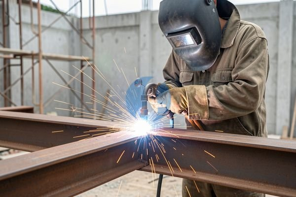

**Las Karbit Terdekat dari Lokasi Saya? Cek Dulu Hal Ini** - Mitra Sumber Material yang budiman, ## Butuh Las Karbit Cepat & Andal? Kami Solusinya!



Mitra Sumber Material, saat proyek konstruksi Anda membutuhkan penyambungan besi dengan cepat dan kuat, las karbit seringkali menjadi pilihan utama. Nah, mencari tukang las karbit terdekat dari lokasi Anda bisa jadi tantangan tersendiri. Tenang saja, Kami dari Sumber Material siap membantu! Kami menyediakan layanan las karbit profesional di wilayah Jabodetabek dan sekitarnya.

## Apa Itu Las Karbit dan Kapan Digunakan?

Las karbit, atau sering disebut juga las gas, menggunakan gas asetilen dan oksigen untuk menghasilkan panas yang cukup tinggi guna melelehkan logam. Proses ini cocok untuk berbagai jenis besi dan baja, khususnya untuk pekerjaan konstruksi yang membutuhkan kekuatan dan ketahanan yang baik. Anda mungkin sering melihatnya digunakan untuk:

- Penyambungan rangka bangunan
- Perbaikan alat berat
- Fabrikasi besi beton
- Pemasangan pagar dan railing

### Pilihan Las Karbit: Jenis Material & Ketebalan Besi

Sebelum memesan jasa las karbit, penting untuk mengetahui jenis material besi yang akan dilas. Apakah itu besi hollow, besi beton, atau baja profil? Begitu juga dengan ketebalannya. Semakin tebal besi, semakin besar kebutuhan gas dan waktu yang dibutuhkan untuk proses pengelasan. Kami menyediakan layanan untuk berbagai jenis dan ketebalan besi.  Untuk besi dengan ketebalan lebih dari 10mm, biasanya dibutuhkan gas asetilen dengan tekanan yang lebih tinggi dan teknik pengelasan yang lebih presisi agar hasil lasannya kuat dan tidak cacat.

Nah, untuk memastikan Anda mendapatkan hasil las yang optimal, jangan ragu untuk konsultasi dengan Kami. Kami bantu memilih teknik las dan gas yang tepat sesuai kebutuhan proyek Anda.  [tanyakan harga terbaru](https://api.whatsapp.com/send?phone=6285776786091&text=*Halo%20sumbermaterial.com*%20%3A)

## Material & Jasa Las Karbit yang Kami Sediakan

Sumber Material bukan hanya menyediakan material bangunan, tapi juga jasa las karbit profesional. Kami melayani:

- **Las Karbit untuk Baja Profil:** Cocok untuk konstruksi rangka bangunan, gudang, dan pabrik. Kami menggunakan baja profil dengan berbagai ukuran SNI, mulai dari profil ringan hingga berat.
- **Las Karbit untuk Besi Hollow:** Ideal untuk pemasangan rangka pintu, jendela, pagar, dan railing. Kami menyediakan besi hollow galvanis atau hitam dengan ketebalan 1.2mm, 1.6mm, 2.0mm, dan seterusnya.
- **Las Karbit untuk Besi Beton:** Proses ini biasanya dilakukan untuk menyambung tulangan besi beton pada proyek konstruksi bangunan bertingkat, jembatan, atau infrastruktur lainnya. Kami menggunakan besi beton dengan berbagai diameter (8mm, 10mm, 12mm, 16mm, dst.) sesuai kebutuhan.
- **Jasa Urug & Jasa Cor:**  Kami juga menyediakan jasa urug dan jasa cor yang bisa dikombinasikan dengan layanan las karbit untuk proyek konstruksi yang lebih komprehensif.

## Kenapa Memilih Sumber Material untuk Jasa Las Karbit?

Mitra Sumber Material, memilih Sumber Material berarti Anda memilih kemudahan dan keandalan.  Kami memastikan Anda tidak salah beli material atau jasa yang tidak sesuai dengan kebutuhan. Beberapa alasan memilih Kami:

- **Pengalaman & Keahlian:** Tukang las karbit Kami sudah berpengalaman dalam berbagai jenis proyek konstruksi.
- **Material Berkualitas:** Kami hanya menggunakan gas asetilen dan oksigen berkualitas tinggi untuk hasil las yang kuat dan tahan lama.
- **Harga Kompetitif:** Kami menawarkan harga yang bersaing tanpa mengorbankan kualitas. Harga ini bersifat estimasi dan dapat berubah sewaktu-waktu — hubungi Kami untuk penawaran terbaru dan paling akurat sesuai kebutuhan proyek Mitra.
- **Pengiriman Tepat Waktu:** Kami melayani pengiriman material dan layanan las karbit ke lokasi proyek Anda di wilayah Jabodetabek dan sekitarnya.
- **Konsultasi Gratis:** Kami siap memberikan konsultasi gratis untuk membantu Anda menentukan jenis las karbit yang paling sesuai dengan kebutuhan proyek Anda.
- **Berlokasi Strategis:** Kami memiliki cabang di Bogor, Jakarta, Bekasi, Karawang, Tangerang, dan Cikarang, memudahkan akses dan pengiriman material.

## Pesan Jasa Las Karbit: Mudah & Cepat

Memesan jasa las karbit dari Sumber Material sangat mudah! Berikut langkah-langkahnya:

1.  **Hubungi Kami:** Kirim kebutuhan dan lokasi proyek Anda melalui tombol **WhatsApp** atau **Telepon** di bawah.
2.  **Konsultasi:** Tim Kami akan menghubungi Anda untuk mendiskusikan detail proyek dan memberikan penawaran harga.
3.  **Konfirmasi:** Setelah Anda menyetujui penawaran, Kami akan menjadwalkan layanan las karbit sesuai dengan waktu yang Anda inginkan.
4.  **Pengerjaan:** Tukang las karbit Kami akan datang ke lokasi proyek Anda dan menyelesaikan pekerjaan dengan profesional.

Kirim kebutuhan dan lokasi proyek Mitra Sumber Material lewat tombol **WhatsApp** atau **Telepon** di bawah, tim Kami bantu siapkan penawarannya.

ARTIKEL_SELESAI

## Perhatikan Posisi Las: Pengaruhnya pada Kekuatan Sambungan

Mitra Sumber Material, kualitas hasil las karbit tidak hanya bergantung pada keahlian tukang las dan material yang digunakan, tapi juga pada posisi pengelasan. Posisi las yang berbeda memerlukan teknik yang berbeda pula, dan memengaruhi kekuatan sambungan akhir. Ada empat posisi dasar dalam pengelasan: *flat* (datar), *horizontal* (mendatar), *vertical* (tegak), dan *overhead* (di atas kepala).

Las posisi *flat* adalah yang paling mudah dan menghasilkan sambungan terkuat karena gravitasi membantu proses pengelasan. Posisi *horizontal* membutuhkan sedikit lebih banyak keterampilan karena logam cair cenderung menetes. Las *vertical* dan *overhead* adalah yang paling sulit, membutuhkan kontrol yang sangat baik agar logam cair tidak jatuh dan menghasilkan lasan yang cacat. Nah, untuk proyek konstruksi, posisi *flat* dan *horizontal* paling sering digunakan. Pastikan tukang las yang Anda pilih berpengalaman dalam posisi yang sesuai dengan kebutuhan proyek Anda.

### Perbedaan Las Karbit dengan Metode Pengelasan Lainnya

Mungkin Anda bertanya-tanya, kenapa harus las karbit? Apa bedanya dengan metode pengelasan lain seperti las listrik atau las argon?  Las karbit unggul dalam hal portabilitas – alatnya relatif ringan dan mudah dibawa ke lokasi proyek. Namun, las listrik lebih cepat dan menghasilkan lasan yang lebih bersih. Las argon menghasilkan lasan yang paling presisi dan kuat, namun membutuhkan peralatan yang lebih mahal dan operator yang sangat terlatih. Pemilihan metode pengelasan tergantung pada kebutuhan proyek, anggaran, dan tingkat ketelitian yang diperlukan. Untuk proyek konstruksi skala besar yang membutuhkan kecepatan, las listrik mungkin lebih cocok. Namun, untuk pekerjaan perbaikan atau fabrikasi kecil, las karbit bisa menjadi pilihan yang ekonomis dan praktis.

## Pertanyaan Umum Seputar Jasa Las Karbit

Banyak Mitra Sumber Material yang menanyakan hal-hal berikut terkait jasa las karbit. Kami rangkum jawabannya di sini:

### Berapa Lama Waktu yang Dibutuhkan untuk Melakukan Las Karbit?

Waktu pengerjaan tergantung pada kompleksitas pekerjaan, ketebalan material, dan posisi pengelasan. Untuk penyambungan besi hollow sederhana, mungkin hanya membutuhkan beberapa menit. Namun, untuk fabrikasi rangka baja yang rumit, bisa memakan waktu berjam-jam atau bahkan berhari-hari.

### Apakah Las Karbit Aman Dilakukan?

Las karbit membutuhkan kehati-hatian karena melibatkan penggunaan gas asetilen yang mudah terbakar. Tukang las harus menggunakan peralatan keselamatan yang lengkap, seperti kacamata las, sarung tangan, dan masker. Pastikan juga area kerja memiliki ventilasi yang baik.

### Bagaimana Cara Mengetahui Hasil Las Karbit Berkualitas?

Hasil las karbit yang berkualitas harus terlihat rapi, kuat, dan tidak ada cacat seperti retakan atau porositas. Permukaan lasan harus rata dan menyatu sempurna dengan material induk. Jika Anda ragu, mintalah tukang las untuk melakukan uji tarik atau uji visual untuk memastikan kualitas lasan.

### Apakah Las Karbit Bisa Digunakan untuk Semua Jenis Logam?

Las karbit paling efektif untuk besi dan baja karbon rendah. Untuk logam lain seperti aluminium atau stainless steel, metode pengelasan lain mungkin lebih disarankan.

## Pertimbangan Penting Sebelum Memesan Jasa Las Karbit

Mitra Sumber Material, sebelum Anda memutuskan untuk memesan jasa las karbit, ada beberapa hal yang perlu Anda pertimbangkan agar mendapatkan hasil yang sesuai harapan. Salah satunya adalah mempersiapkan material besi dengan baik. Pastikan besi yang akan dilas bersih dari karat, minyak, atau kotoran lainnya. Permukaan yang kotor dapat menyebabkan lasan menjadi lemah dan mudah retak. Selain itu, pastikan juga ukuran besi yang akan dilas sesuai dengan kebutuhan proyek Anda. Kesalahan dalam pengukuran dapat menyebabkan pemborosan material dan waktu.

## Tips Memilih Gas Karbit yang Berkualitas

Memilih gas karbit yang berkualitas adalah kunci untuk menghasilkan lasan yang kuat dan tahan lama. Gas karbit yang baik harus memiliki kemurnian yang tinggi dan bebas dari kontaminan. Anda bisa mengecek kualitas gas karbit dengan memperhatikan warnanya. Gas karbit yang berkualitas biasanya berwarna jernih dan tidak berbau. Hindari menggunakan gas karbit yang berwarna keruh atau berbau menyengat karena itu bisa jadi indikasi adanya kontaminan. Kami selalu menggunakan gas karbit berkualitas tinggi untuk memastikan hasil lasan yang optimal bagi Mitra Sumber Material.

## Sering Muncul Pertanyaan Ini: Las Karbit di Proyek Anda

### Apakah Las Karbit Bisa untuk Besi Berkarat?

Sebaiknya tidak. Karat mengganggu proses pengelasan dan melemahkan sambungan. Bersihkan karat dulu ya.

### Berapa Ketebalan Besi Maksimal yang Bisa Dilas Karbit?

Tergantung keahlian tukang las dan peralatan. Biasanya aman sampai 12mm, tapi bisa lebih jika menggunakan teknik khusus.

### Apakah Hasil Las Karbit Perlu Dipernis atau Dicat?

Disarankan. Lapisan pelindung mencegah karat dan memperpanjang umur lasan, terutama untuk proyek outdoor.

### Bagaimana Kalau Ada Bagian Las yang Retak Setelah Dingin?

Segera hubungi tukang las. Retakan bisa jadi indikasi kualitas las yang buruk atau material yang tidak sesuai.
