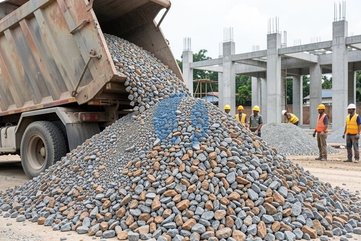

**Cara Memilih Nama Lain Agregat yang Sesuai Kebutuhan** - Mitra Sumber Material yang budiman, pernahkah Anda bertanya-tanya, material apa saja yang benar-benar penting dalam membangun fondasi yang kuat? Kami punya solusinya! Sumber Material menyediakan berbagai jenis agregat berkualitas dengan harga yang kompetitif.



Agregat adalah komponen penting dalam campuran beton, aspal, dan berbagai aplikasi konstruksi lainnya. Tapi, seringkali kita mendengar istilah-istilah berbeda untuk menyebutnya. Nah, artikel ini akan membahas tuntas nama lain agregat, jenis-jenisnya, sampai di mana Anda bisa mendapatkannya dengan mudah. Dengan begitu, proyek Anda – baik renovasi kecil maupun pembangunan besar – bisa berjalan lancar tanpa kendala.

## Memahami Ragam Istilah: Apa Saja Nama Lain Agregat?

Banyak sekali istilah yang digunakan untuk menyebut agregat, tergantung daerah dan aplikasinya. Beberapa yang paling umum adalah “batu pecah”, “kerikil”, “sirtu”, dan “pasir urug”. Mitra Sumber Material, mungkin Anda pernah mendengar istilah-istilah ini tetapi belum tahu persis perbedaannya. Nah, pemahaman ini penting lho! Karena setiap jenis agregat punya karakteristik dan kegunaan yang berbeda. Bayangkan saja, menggunakan agregat yang salah bisa mengurangi kekuatan bangunan dan bahkan membahayakan.

Untuk proyek yang lebih spesifik, Anda mungkin juga mendengar istilah “agregat kasar” dan “agregat halus”. Agregat kasar biasanya merujuk pada kerikil atau batu pecah dengan ukuran lebih besar, sedangkan agregat halus adalah pasir. Nah, untuk memudahkan Anda memilih yang tepat, Kami menyediakan berbagai pilihan jenis dan ukuran agregat sesuai kebutuhan proyek Anda. [tanyakan harga lewat WhatsApp](https://api.whatsapp.com/send?phone=6285776786091&text=*Halo%20sumbermaterial.com*%20%3A)

## Pilihan Agregat di Sumber Material: Jenis, Ukuran, dan Aplikasi

Sumber Material menyediakan berbagai jenis agregat yang bisa Anda pilih sesuai kebutuhan proyek Anda. Beberapa di antaranya:

- **Pasir Urug:** Ideal untuk pengurugan, pembuatan lantai kerja, dan campuran semen. Tersedia dalam berbagai ukuran dan kualitas.
- **Batu Pecah (Split):** Digunakan untuk campuran beton, fondasi, drainase, dan lapisan dasar jalan. Kami menyediakan batu pecah dengan berbagai ukuran, mulai dari 5/20 mm hingga 20/40 mm.
- **Kerikil:** Cocok untuk campuran beton, pembuatan jalan, dan dekorasi lanskap.
- **Sirtu (Pasir, Tanah, dan Kerikil):** Campuran ideal untuk pengurugan, pembuatan jalan sementara, dan stabilisasi tanah.

Sebagai contoh, untuk membangun fondasi rumah, Anda membutuhkan agregat kasar seperti batu pecah ukuran 20/40 mm untuk memberikan kekuatan dan stabilitas. Sementara untuk membuat lantai kerja, pasir urug dengan ukuran yang lebih halus akan lebih cocok. Kami siap membantu Anda memilih jenis dan ukuran agregat yang tepat untuk proyek Anda.

## Mengapa Memilih Sumber Material untuk Kebutuhan Agregat Anda?

Mitra Sumber Material, Kami mengerti betul pentingnya mendapatkan material bangunan berkualitas dengan harga yang kompetitif. Itulah mengapa Kami hadir sebagai solusi terbaik untuk kebutuhan agregat Anda. Kami tidak hanya menyediakan berbagai jenis agregat, tetapi juga memberikan layanan yang memuaskan dan terpercaya.

Berikut beberapa alasan mengapa Anda harus memilih Sumber Material:

- **Kualitas Terjamin:** Kami hanya menyediakan agregat yang memenuhi standar SNI.
- **Harga Kompetitif:** Kami menawarkan harga yang bersaing di pasaran.
- **Pengiriman Tepat Waktu:** Kami melayani pengiriman ke seluruh wilayah Jabodetabek dan sekitarnya.
- **Layanan Konsultasi:** Tim Kami siap membantu Anda memilih agregat yang tepat untuk proyek Anda.
- **Terpercaya:** Kami telah berpengalaman dalam menyediakan material bangunan untuk berbagai proyek, mulai dari renovasi rumah hingga pembangunan gedung bertingkat.

Kami berlokasi strategis di Bogor, Jakarta, Bekasi, Karawang, Tangerang, dan Cikarang, sehingga memudahkan Kami untuk menjangkau proyek Anda dengan cepat dan efisien.

## Pesan Agregat Sekarang: Mudah, Cepat, dan Terpercaya

Pesan agregat dari Sumber Material sangat mudah! Cukup hubungi Kami melalui tombol **WhatsApp** atau **Telepon** yang tersedia di halaman ini. Sampaikan kebutuhan dan lokasi proyek Anda, dan Kami akan bantu hitungkan biaya serta mengatur pengiriman. Kami juga melayani sewa alat berat serta jasa urug dan jasa cor, jadi Anda bisa mendapatkan semua kebutuhan konstruksi Anda dalam satu tempat. Jangan ragu untuk berkonsultasi dengan tim Kami jika Anda membutuhkan bantuan dalam memilih jenis agregat yang tepat.

Mau tahu harga terbaru untuk kebutuhan proyek Mitra Sumber Material? Klik tombol **WhatsApp** atau **Telepon** di bawah, kirim kebutuhan dan lokasi proyek, Kami bantu hitungkan.

ARTIKEL_SELESAI

## Menghitung Kebutuhan Agregat: Contoh Praktis untuk Proyek Anda

Mitra Sumber Material, seringkali kita kesulitan memperkirakan berapa banyak agregat yang dibutuhkan untuk sebuah proyek. Hal ini bisa menyebabkan pemborosan atau bahkan kekurangan material. Nah, Kami akan berikan contoh perhitungan sederhana untuk membantu Anda.

Perhitungan ini hanyalah contoh sederhana. Untuk proyek yang lebih kompleks, Anda bisa berkonsultasi dengan Kami dan Kami akan bantu menghitung kebutuhan agregat Anda secara akurat.

## Perbandingan Agregat: Batu Pecah vs. Kerikil – Mana yang Lebih Cocok?

Mitra Sumber Material, memilih antara batu pecah dan kerikil seringkali membingungkan. Keduanya sama-sama agregat kasar, tetapi memiliki perbedaan yang signifikan. Batu pecah dihasilkan dari pemecahan batu alam, sehingga memiliki bentuk yang lebih tajam dan bersudut. Sementara itu, kerikil berasal dari erosi alami sungai atau laut, sehingga bentuknya lebih bulat dan halus.

Secara umum, batu pecah lebih cocok untuk aplikasi yang membutuhkan kekuatan dan interlocking yang tinggi, seperti pembuatan beton bertulang untuk fondasi atau kolom. Bentuknya yang tajam membantu mengunci agregat dengan semen, menciptakan campuran yang lebih kuat dan tahan lama. Sementara itu, kerikil lebih cocok untuk aplikasi yang membutuhkan drainase yang baik, seperti pembuatan jalan atau lapisan drainase. Bentuknya yang bulat memungkinkan air mengalir dengan lebih mudah.

Untuk proyek yang membutuhkan estetika tertentu, kerikil juga bisa digunakan sebagai lapisan dekoratif, misalnya untuk taman atau walkway. Kami menyediakan berbagai pilihan batu pecah dan kerikil dengan berbagai ukuran dan warna, sehingga Anda bisa memilih yang paling sesuai dengan kebutuhan dan preferensi Anda.

## Pertanyaan Umum Seputar Agregat: Seputar Pemilihan dan Pemesanan

Kami sering menerima pertanyaan dari Mitra Sumber Material mengenai agregat. Berikut beberapa pertanyaan yang paling umum dan jawabannya:

### Berapa Ukuran Agregat yang Cocok untuk Fondasi Rumah?

Untuk fondasi rumah, umumnya digunakan batu pecah dengan ukuran 20/40 mm atau 40/60 mm. Ukuran ini memberikan kekuatan dan stabilitas yang cukup untuk menahan beban bangunan.

### Apakah Sirtu Bisa Digunakan untuk Semua Jenis Tanah?

Sirtu sangat efektif untuk menstabilkan tanah yang berpasir atau berlumpur. Namun, untuk tanah yang sangat lempung atau berbatu, mungkin diperlukan metode stabilisasi yang lain.

### Bagaimana Cara Memastikan Kualitas Pasir Urug yang Kami Terima?

Pastikan pasir urug yang Anda terima bersih dari kotoran organik, lumpur, dan material asing lainnya. Selain itu, periksa juga teksturnya – pasir urug yang baik memiliki tekstur yang kasar dan tidak terlalu halus.

### Bagaimana Cara Terbaik Menyimpan Agregat Setelah Diterima?

Agregat sebaiknya disimpan di tempat yang kering dan terlindung dari hujan. Jika disimpan di luar ruangan, tutupi dengan terpal untuk mencegah kontaminasi dan penurunan kualitas.

ARTIKEL_SELESAI

## Meminimalisir Kesalahan Umum dalam Pemesanan Agregat

Mitra Sumber Material, seringkali ada beberapa kesalahan kecil yang tanpa sadar bisa terjadi saat memesan agregat. Salah satunya adalah tidak memperhitungkan faktor *bulk density* atau berat jenis material. Setiap jenis agregat memiliki berat jenis yang berbeda, yang akan memengaruhi volume yang Anda butuhkan. Misalnya, satu truk batu pecah mungkin memiliki berat yang berbeda dengan satu truk pasir urug dengan volume yang sama. Nah, Kami di Sumber Material siap membantu Anda menghitung volume yang tepat berdasarkan berat jenis material yang Anda pilih.

## Tanya Jawab Seputar Agregat: Seputar Kualitas dan Penggunaan

Berikut beberapa pertanyaan yang sering Kami terima dari Mitra Sumber Material:

### Apakah Agregat Basah Mempengaruhi Kekuatan Beton?

Ya, agregat yang terlalu basah dapat mengurangi kekuatan beton karena air berlebih akan mengurangi kandungan semen yang efektif.

### Bagaimana Cara Mengidentifikasi Agregat Berkualitas?

Perhatikan warna, bentuk, dan tekstur agregat. Agregat berkualitas baik umumnya memiliki warna yang seragam, bentuk yang tajam (untuk agregat kasar), dan bebas dari kotoran organik atau lumpur.

### Bisakah Agregat Didaur Ulang?

Tentu saja! Agregat daur ulang, seperti hasil pembongkaran jalan atau bangunan, dapat digunakan kembali dalam beberapa aplikasi, seperti lapisan dasar atau pengurugan.

### Apa Perbedaan Sirtu dan Agregat Campuran?

Sirtu adalah campuran alami pasir, tanah, dan kerikil. Sementara agregat campuran adalah hasil pencampuran material buatan dengan proporsi tertentu.
