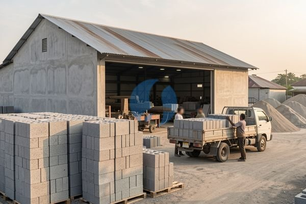

**Pabrik Batako Terdekat? Cek Dulu Hal Ini** - Mitra Sumber Material yang kami hormati, seringkali proyek konstruksi terhambat karena sulit menemukan supplier batako yang tepat. Banyak yang akhirnya memesan dari tempat yang jauh, mengakibatkan biaya transportasi membengkak dan waktu tunggu yang lama. Nah, Kami di Sumber Material hadir untuk membantu Anda menghindari masalah tersebut sebelum memesan.



Mitra, memilih batako yang tepat itu krusial. Ukuran yang tidak sesuai, mutu yang kurang baik, atau bahkan penawaran harga yang tidak transparan bisa jadi bumerang bagi kelancaran proyek Anda.  Oleh karena itu, penting untuk mengetahui opsi yang tersedia dan bagaimana memilih yang paling sesuai dengan kebutuhan. Kami akan bantu mengulas beberapa pertimbangan penting, dan tentu saja, menawarkan solusi yang tepat untuk kebutuhan batako Anda.

## Cari Batako Berkualitas? Pertimbangkan Jenis dan Ukuran yang Tepat

Saat mencari pabrik batako terdekat, jangan hanya terpaku pada harga murah. Perhatikan jenis batako yang dibutuhkan. Ada batako press, batako cetak, batako ringan, dan lain sebagainya. Masing-masing memiliki kelebihan dan kekurangan. Misalnya, batako press cenderung lebih kuat dan tahan lama, sementara batako ringan lebih mudah dipasang dan mengurangi beban struktur bangunan.

Anda juga perlu mempertimbangkan ukuran batako yang sesuai dengan desain bangunan. Ukuran standar batako adalah 40x20x10 cm, namun ada juga variasi lain.  Ketidaktepatan ukuran dapat menyebabkan masalah saat pemasangan dan mengurangi efisiensi penggunaan material.

Untuk membantu Anda menentukan pilihan, Kami sarankan untuk berkonsultasi terlebih dahulu.  Tim Kami siap memberikan saran mengenai jenis dan ukuran batako yang paling optimal untuk proyek Anda. Jangan ragu untuk [tanyakan saran ahli](https://api.whatsapp.com/send?phone=6285776786091&text=*Halo%20sumbermaterial.com*%20%3A).

## Pilihan Batako Lengkap di Sumber Material: Press, Cetak, dan Ukuran Custom

Kami di Sumber Material menyediakan berbagai jenis batako berkualitas, termasuk batako press dan batako cetak. Batako press Kami diproduksi dengan mesin modern dan menggunakan bahan baku pilihan, sehingga menghasilkan produk yang kuat, tahan lama, dan presisi. Batako cetak Kami juga menawarkan kualitas yang baik dengan harga yang lebih ekonomis.

Berikut beberapa variasi batako yang tersedia:

- **Batako Press:** Ideal untuk dinding yang membutuhkan kekuatan tinggi dan ketahanan terhadap cuaca ekstrem.
- **Batako Cetak:** Cocok untuk bangunan yang tidak memerlukan kekuatan struktural yang terlalu besar, seperti dinding pembatas atau pagar.
- **Ukuran Custom:** Kami juga menerima pesanan batako dengan ukuran khusus sesuai kebutuhan proyek Anda.

Selain itu, Kami juga menyediakan berbagai ukuran batako standar, termasuk 40x20x10 cm, 39x19x10 cm, dan lain-lain.  Semua produk Kami memenuhi standar mutu SNI, sehingga Anda tidak perlu khawatir dengan kualitasnya.

## Mengapa Memilih Sumber Material untuk Kebutuhan Batako Anda?

Mitra Sumber Material, memesan batako dari Kami bukan hanya soal mendapatkan material bangunan, tapi juga mendapatkan solusi lengkap untuk proyek Anda.  Kami memahami betul pentingnya ketepatan waktu dan kualitas, itulah sebabnya Kami selalu berusaha memberikan pelayanan terbaik.

Pertama, Kami adalah supplier terpercaya yang telah berpengalaman dalam menyediakan material bangunan berkualitas untuk berbagai proyek di Jabodetabek dan sekitarnya.  Kedua, Kami menawarkan harga yang kompetitif tanpa mengorbankan kualitas. Ketiga, Kami menyediakan layanan konsultasi gratis untuk membantu Anda memilih jenis dan ukuran batako yang tepat.

Yang terpenting, Kami melayani pengiriman langsung ke lokasi proyek Anda.  Dengan armada yang lengkap, Kami mampu mengirimkan batako dalam jumlah besar secara efisien dan tepat waktu.  Kami berlokasi strategis di Bogor, Jakarta, Bekasi, Karawang, Tangerang, dan Cikarang, sehingga pengiriman lebih cepat dan biaya lebih hemat.

Jangan buang waktu berburu pabrik batako terdekat yang belum tentu bisa memberikan layanan terbaik. Percayakan kebutuhan batako Anda pada Kami!

## Pesan Batako Mudah & Cepat: Konsultasi Dulu, Baru Pesan!

Proses pemesanan batako di Sumber Material sangat mudah dan cepat.  Anda cukup menghubungi Kami lewat tombol **Telepon** atau **WhatsApp** yang ada di halaman ini.  Tim Kami akan dengan senang hati membantu Anda menghitung kebutuhan batako, memberikan penawaran harga terbaik, dan mengatur jadwal pengiriman.

Ingat, Kami sangat menganjurkan untuk berkonsultasi terlebih dahulu sebelum memesan.  Dengan begitu, Anda bisa mendapatkan batako yang sesuai dengan kebutuhan proyek Anda dan menghindari kesalahan pemesanan yang bisa merugikan.

Tinggal satu langkah lagi: hubungi Kami lewat tombol **Telepon** atau **WhatsApp** di bawah untuk menanyakan harga dan jadwal pengiriman proyek Mitra Sumber Material.

ARTIKEL_SELESAI

## Hitung Kebutuhan Batako: Contoh Praktis untuk Proyek Anda

Mitra Sumber Material, seringkali kita kesulitan memperkirakan jumlah batako yang dibutuhkan untuk suatu proyek. Akibatnya, bisa terjadi kekurangan material di tengah pekerjaan atau kelebihan yang justru memboroskan anggaran. Nah, mari kita lihat contoh perhitungan sederhana untuk membantu Anda.

Misalkan Anda akan membangun dinding dengan ukuran panjang 8 meter dan tinggi 2,5 meter. Kita asumsikan ketebalan dinding adalah 15 cm (setengah bata). Ukuran batako standar yang akan kita gunakan adalah 40x20x10 cm.

Pertama, hitung luas dinding: 8m x 2,5m = 20 m². Kemudian, hitung luas satu batako dalam meter persegi: 0,4m x 0,2m = 0,08 m².  Untuk mengetahui jumlah batako per meter persegi, bagi luas dinding dengan luas satu batako: 1 m² / 0,08 m² = 12,5 batako.

Perhitungan ini adalah estimasi dasar. Faktor lain seperti desain dinding (ada bukaan atau tidak) dan jenis pemasangan batako juga dapat memengaruhi jumlah kebutuhan. Kami sarankan untuk berkonsultasi dengan Kami agar mendapatkan perhitungan yang lebih akurat sesuai dengan proyek Anda.

## Batako Press vs. Batako Cetak: Mana yang Lebih Cocok untuk Proyek Anda?

Mitra, memilih antara batako press dan batako cetak seringkali membingungkan. Keduanya memiliki keunggulan dan kekurangan masing-masing.  Mari kita bandingkan secara lebih detail agar Anda bisa membuat keputusan yang tepat.

Batako press, seperti yang sudah Kami sebutkan, menawarkan kekuatan yang lebih tinggi. Ini karena proses pembuatannya yang melibatkan tekanan tinggi, sehingga molekul-molekul material batako menjadi lebih padat dan terikat kuat.  Batako press ideal untuk struktur yang membutuhkan daya tahan tinggi, seperti dinding penahan tanah atau fondasi bangunan.

Di sisi lain, batako cetak memiliki keunggulan dari segi harga yang lebih ekonomis dan proses pemasangan yang lebih cepat.  Batako cetak memiliki permukaan yang lebih rata, sehingga lebih mudah ditempel dengan semen atau plester.  Namun, perlu diingat bahwa kekuatan batako cetak umumnya lebih rendah dibandingkan batako press.

Secara ringkas, berikut perbandingan keduanya:

- **Kekuatan:** Batako Press > Batako Cetak
- **Harga:** Batako Cetak < Batako Press
- **Kemudahan Pemasangan:** Batako Cetak > Batako Press
- **Penggunaan Ideal:** Batako Press (struktur kuat), Batako Cetak (dinding pembatas/pagar)

## Pertanyaan Umum Seputar Batako: Kami Jawab untuk Anda

Ada beberapa pertanyaan yang sering Kami terima dari Mitra Sumber Material terkait batako. Berikut beberapa di antaranya:

### Berapa Daya Tahan Batako Terhadap Cuaca?

Batako pada dasarnya cukup tahan terhadap cuaca, terutama jika terbuat dari material berkualitas dan diproses dengan benar. Namun, batako tetap membutuhkan perlindungan tambahan, seperti pelapisan anti air, untuk mencegah kerusakan akibat hujan atau kelembapan jangka panjang.

### Apakah Batako Mudah Retak atau Pecah?

Batako bisa retak atau pecah jika terkena benturan keras atau tekanan berlebihan. Oleh karena itu, penting untuk menangani batako dengan hati-hati saat pengangkutan dan pemasangan. Memilih batako press juga bisa meminimalkan risiko kerusakan karena kekuatannya yang lebih tinggi.

### Bagaimana Cara Merawat Dinding Batako Agar Awet?

Perawatan dinding batako cukup sederhana. Secara berkala bersihkan dinding dari debu dan kotoran. Jika ada retakan kecil, segera perbaiki dengan semen atau plester.  Pelapisan anti air juga dapat membantu melindungi dinding dari kerusakan akibat cuaca.

### Apakah Batako Bisa Digunakan untuk Lantai?

Secara umum, batako kurang ideal digunakan untuk lantai karena tidak memiliki permukaan yang rata dan mudah aus jika terkena beban berat. Namun, ada jenis batako khusus yang dirancang untuk lantai, seperti batako ringan dengan lapisan pelindung. Lebih baik konsultasikan dengan Kami untuk solusi terbaik sesuai kebutuhan Anda.
