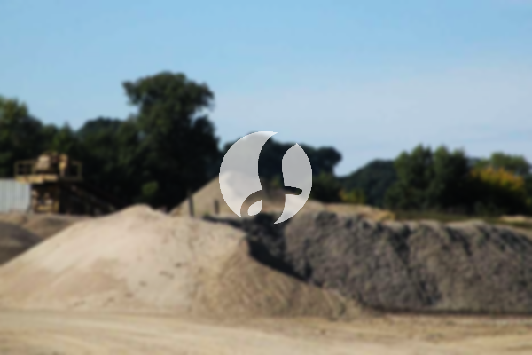

**Memahami Pasir Abu Batu Harga sebelum Memesan** - Mitra, pernahkah Anda kesulitan mencari supplier pasir abu batu yang tepat untuk proyek konstruksi? Terkadang, mendapatkan harga yang pas dan kualitas yang terjamin itu bikin pusing. Nah, di Sumber Material, Kami siap membantu Anda mendapatkan kedua hal itu sekaligus. Bayangkan, Anda tinggal kirim kebutuhan dan lokasi proyek, Kami bantu hitungkan volume pasir abu batu yang diperlukan, lalu kami kirim langsung ke lokasi Anda di Jabodetabek dan sekitarnya.



## Mencari Pasir Abu Batu yang Tepat: Pertimbangan Utama

Sebelum membahas harga, penting untuk memahami dulu apa yang membuat pasir abu batu ini penting dalam proyek Anda. Pasir abu batu, hasil dari sisa-sisa pembakaran batu bara, seringkali menjadi pilihan ekonomis untuk berbagai aplikasi konstruksi. Namun, kualitasnya bisa bervariasi. Mitra Sumber Material perlu mempertimbangkan beberapa hal: ukuran butir, kandungan lumpur, dan tingkat kekerasan. Semakin halus butirannya dan semakin rendah kandungan lumpurnya, umumnya semakin baik kualitas pasir abu batu tersebut.

Nah, daripada bingung membandingkan satu supplier dengan supplier lain, kenapa tidak serahkan saja perhitungan kebutuhan dan pencarian supplier terbaik kepada Kami? Kami bisa memberikan rekomendasi material yang sesuai dengan anggaran dan spesifikasi proyek Anda.

## Pasir Abu Batu: Jenis, Ukuran, dan Aplikasi Nyata

Ada beberapa jenis pasir abu batu yang beredar di pasaran, masing-masing dengan karakteristiknya sendiri. Secara umum, pasir abu batu dibedakan berdasarkan ukuran butirnya: halus, sedang, dan kasar.  Pasir abu batu halus cocok untuk campuran semen dan plester, sementara yang sedang dan kasar lebih sering digunakan untuk urugan dan pembuatan pondasi.

Contohnya, untuk proyek lantai kerja seluas 50 meter persegi dengan ketebalan 5 cm, Anda membutuhkan sekitar 2,5 meter kubik pasir abu batu.  Dengan harga rata-rata (estimasi) Rp 150.000 – Rp 250.000 per meter kubik (harga ini bersifat estimasi dan dapat berubah sewaktu-waktu — hubungi Kami untuk penawaran terbaru dan paling akurat sesuai kebutuhan proyek Mitra), biaya total pasir abu batu bisa berkisar antara Rp 375.000 – Rp 625.000.

Selain itu, Kami juga menyediakan berbagai jenis material bangunan lain yang mungkin Anda butuhkan, seperti batu split, pasir urug, dan semen.  Semua bisa dipesan dengan mudah melalui Kami. Mau tahu daftar lengkap material Kami? Kirim kebutuhan proyek Anda lewat WhatsApp sekarang!

## Kenapa Pesan Pasir Abu Batu di Sumber Material?

Mitra, Kami mengerti betapa pentingnya mendapatkan material bangunan yang berkualitas dengan harga yang bersaing. Itulah kenapa Kami hadir untuk mempermudah proses pemesanan Anda. Sumber Material tidak hanya menawarkan pasir abu batu dengan berbagai ukuran dan kualitas, tetapi juga memberikan kemudahan dalam pemesanan. Cukup kirim kebutuhan dan lokasi proyek Anda melalui tombol **WhatsApp** atau **Telepon** di halaman ini, dan Kami akan bantu hitungkan kebutuhan material yang tepat.

Kami melayani wilayah Jabodetabek dan sekitarnya, termasuk Bogor, Jakarta, Bekasi, Karawang, Tangerang, dan Cikarang.  Kami berkomitmen untuk mengirimkan material tepat waktu dan sesuai dengan pesanan Anda.  Kami juga menyediakan jasa urug dan sewa alat berat jika Anda membutuhkannya. Dengan Kami, Anda bisa fokus pada pelaksanaan proyek tanpa perlu khawatir tentang ketersediaan material.

## Cara Mudah Pesan Pasir Abu Batu di Sumber Material

Proses pemesanan di Sumber Material sangat mudah dan cepat. Berikut langkah-langkahnya:

1.  **Hubungi Kami:** Klik tombol **WhatsApp** atau **Telepon** di bawah.
2.  **Sampaikan Kebutuhan:** Beritahu Kami jenis material (pasir abu batu), volume yang dibutuhkan, dan lokasi proyek Anda.
3.  **Dapatkan Penawaran:** Kami akan segera memberikan penawaran harga terbaik sesuai kebutuhan Anda.
4.  **Konfirmasi & Jadwalkan Pengiriman:** Setelah Anda setuju dengan penawaran, Kami akan jadwalkan pengiriman ke lokasi proyek Anda.

## Menghitung Kebutuhan Pasir Abu Batu: Studi Kasus Proyek Nyata

Mitra, seringkali kita bingung menghitung berapa banyak pasir abu batu yang sebenarnya dibutuhkan untuk sebuah proyek. Nah, Kami akan berikan contoh perhitungan yang lebih detail. Katakanlah Anda akan membuat lantai kerja untuk gudang berukuran 10 meter x 8 meter dengan ketebalan 10 cm. Pertama, hitung volume totalnya: 10 m x 8 m x 0,1 m = 8 meter kubik.

## FAQ: Pertanyaan Umum Seputar Pasir Abu Batu

Banyak Mitra Sumber Material yang menanyakan hal serupa. Berikut beberapa pertanyaan yang sering muncul:

### Berapa perbedaan pasir abu batu halus dan kasar?

Perbedaan utamanya terletak pada ukuran butirannya. Pasir abu batu halus lebih cocok untuk campuran semen dan plester karena memberikan tekstur yang lebih halus dan mudah dikerjakan. Sementara itu, pasir abu batu kasar lebih ideal untuk urugan dan pondasi karena memiliki daya dukung yang lebih tinggi.

### Apakah pasir abu batu aman untuk lingkungan?

Pasir abu batu merupakan produk sampingan dari pembakaran batu bara, jadi penting untuk memastikan sumbernya berasal dari pembangkit listrik yang memiliki sistem pengelolaan limbah yang baik. Kami di Sumber Material hanya bekerja sama dengan supplier yang bertanggung jawab dan memenuhi standar lingkungan.

### Bagaimana cara mengetahui kualitas pasir abu batu?

Perhatikan warna dan teksturnya. Pasir abu batu yang berkualitas baik umumnya berwarna abu-abu gelap atau hitam, dengan tekstur yang seragam dan tidak terlalu banyak mengandung lumpur atau kotoran organik. Anda juga bisa melakukan uji saringan sederhana untuk mengetahui ukuran butirannya.

### Bisakah pasir abu batu digunakan untuk membuat lantai?

Bisa, tapi tidak disarankan untuk lantai yang membutuhkan kekuatan dan daya tahan tinggi. Pasir abu batu lebih cocok untuk lantai kerja atau lantai dasar yang tidak terlalu terbebani. Untuk lantai utama, sebaiknya gunakan material yang lebih kuat seperti pasir beton atau pasir silica.

## Hindari Kesalahan Umum Saat Membeli Pasir Abu Batu

Mitra, membeli material bangunan tanpa perencanaan yang matang bisa berakibat fatal.  Seringkali Kami melihat pembeli yang kurang teliti dan akhirnya menghadapi masalah di kemudian hari. Salah satu kesalahan umum adalah tidak memperhatikan kandungan lumpur dalam pasir abu batu. Kandungan lumpur yang tinggi dapat mengurangi kekuatan campuran semen dan menyebabkan retak pada struktur bangunan.

Kesalahan lainnya adalah membeli pasir abu batu dari supplier yang tidak terpercaya. Pastikan supplier memiliki reputasi yang baik dan dapat menjamin kualitas materialnya. Jangan tergiur dengan harga yang terlalu murah, karena kualitasnya mungkin juga rendah. Lalu, jangan lupa untuk memperhitungkan biaya transportasi dan pengiriman. Terkadang, harga material yang murah bisa jadi lebih mahal jika biaya pengirimannya tinggi. Dengan menghindari kesalahan-kesalahan ini, Anda bisa memastikan proyek Anda berjalan lancar dan hasilnya memuaskan.

## Memahami Kekuatan dan Batasan Pasir Abu Batu

Mitra, penting untuk memahami bahwa pasir abu batu memiliki kelebihan dan kekurangan. Kekuatan tekan pasir abu batu memang lebih rendah dibandingkan pasir alam atau pasir silica. Ini perlu diperhatikan terutama jika Anda merencanakan proyek yang membutuhkan daya dukung tinggi, seperti struktur bangunan bertingkat atau jalan raya. Namun, untuk aplikasi seperti lantai kerja, urugan, atau lapisan bawah pondasi, pasir abu batu bisa menjadi pilihan yang ekonomis dan efektif. Kami sarankan untuk selalu berkonsultasi dengan ahli konstruksi untuk memastikan material yang Anda pilih sesuai dengan kebutuhan proyek Anda.

## Pertanyaan Umum Lainnya Seputar Pasir Abu Batu

### Apakah pasir abu batu bisa menyebabkan korosi pada besi?

Secara teoritis, kandungan sulfur pada pasir abu batu dapat mempercepat korosi besi. Namun, dalam prakteknya, risiko ini bisa diminimalkan dengan menggunakan lapisan pelindung atau menambahkan aditif anti-korosi pada campuran semen.

### Bagaimana cara menyimpan pasir abu batu dengan benar?

Simpan pasir abu batu di tempat yang kering dan terlindung dari hujan. Tutupi dengan terpal atau plastik jika perlu. Ini akan mencegah material menyerap air dan menggumpal, sehingga tetap mudah digunakan.

### Apakah pasir abu batu mengandung zat berbahaya?

Kandungan zat berbahaya pada pasir abu batu bervariasi tergantung pada sumber batu bara yang digunakan. Kami di Sumber Material hanya menyediakan pasir abu batu yang telah diuji dan memenuhi standar keamanan yang berlaku.

### Bisakah pasir abu batu digunakan untuk membuat paving block?

Tidak disarankan. Pasir abu batu kurang ideal untuk paving block karena kekuatan dan daya tahannya yang relatif rendah. Material yang lebih cocok untuk paving block adalah pasir urug yang bersih dan memiliki butiran yang kasar.

Mau tahu harga terbaru untuk kebutuhan proyek Mitra Sumber Material? Klik tombol **WhatsApp** atau **Telepon** di bawah, kirim kebutuhan dan lokasi proyek, Kami bantu hitungkan.
