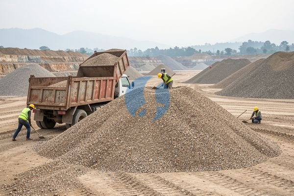

**Memahami Pasir Batu Cianjur sebelum Memesan** - Mitra Sumber Material yang berbahagia, pernahkah Anda menghadapi kendala mencari pasir dan batu yang benar-benar berkualitas untuk proyek konstruksi? Banyak kontraktor atau pemilik rumah yang akhirnya menerima material kurang baik, yang berujung pada masalah di kemudian hari. Nah, Kami di Sumber Material khusus menyediakan pasir dan batu dari Cianjur yang terkenal akan kualitasnya. Kami bantu memastikan pesanan Anda tepat dan beres, sesuai kebutuhan proyek Anda!



## Mencari Pasir dan Batu Cianjur yang Pas untuk Kebutuhan Anda

Memilih pasir dan batu untuk konstruksi memang gampang-gampang susah ya, Mitra? Ada banyak jenis dan ukuran yang tersedia, masing-masing punya keunggulan dan kekurangan. Biasanya, kontraktor atau pemilik rumah mencari yang harganya bersaing, tapi jangan sampai mengorbankan kualitas. Pasir dan batu yang bagus itu penting banget, lho, untuk kekuatan dan umur bangunan.

Nah, kalau Anda sedang mempertimbangkan pasir dan batu dari Cianjur, ini pilihan yang tepat. Kenapa? Karena pasir dan batu dari Cianjur terkenal dengan butiran yang bersih, kuat, dan minim lumpur. Ini sangat berpengaruh pada kualitas adukan beton atau material urug. Tapi, bagaimana memastikan Anda mendapatkan kualitas terbaik? Ini bedanya memesan lewat Kami: Kami hanya menyediakan material yang sudah melewati seleksi ketat. Sebelum Anda memutuskan, Kami sarankan Anda konsultasikan dulu kebutuhan proyek Anda. Kirim detail proyek dan lokasi ke WhatsApp Kami, dan tim Kami akan bantu memberikan rekomendasi terbaik!

## Pasir dan Batu Cianjur: Jenis dan Pilihan yang Tersedia

Kami di Sumber Material menyediakan berbagai jenis pasir dan batu Cianjur, disesuaikan dengan kebutuhan proyek Anda. Untuk pasir, kami punya pasir urug, pasir pasang, dan pasir beton. Pasir urug cocok untuk pengurugan lahan atau pondasi, pasir pasang untuk plesteran dan acian, sedangkan pasir beton untuk campuran adukan beton yang kuat. Batu yang kami sediakan juga bervariasi, mulai dari batu split ukuran 5/7, 7/10, 10/15, hingga batu kerikil.

Sebagai gambaran, kalau Anda mau membangun rumah dua lantai, Kami rekomendasikan kombinasi pasir beton untuk pondasi dan kolom, batu split ukuran 10/15 untuk struktur beton, dan pasir pasang untuk pekerjaan plesteran. Kalau proyek Anda hanya membutuhkan urugan, pasir urug Cianjur adalah pilihan tepat karena harganya yang ekonomis dan kualitasnya yang terjamin. Untuk proyek skala besar seperti jalan atau jembatan, Kami juga siap memasok dalam jumlah besar dengan harga yang kompetitif.

## Kenapa Harus Pesan Pasir Batu Cianjur di Sumber Material?

Kami sadar, Anda punya banyak pilihan tempat membeli pasir dan batu. Tapi, ada beberapa alasan kenapa memilih Kami bisa memberikan ketenangan pikiran dan keuntungan lebih, Mitra Sumber Material. Pertama, kualitas terjamin. Kami hanya bekerja sama dengan penambang pasir dan batu Cianjur yang terpercaya dan menghasilkan material berkualitas tinggi. Kedua, Kami punya stok yang selalu tersedia, sehingga Anda tidak perlu khawatir kehabisan material di tengah proyek. Ketiga, Kami melayani pengiriman ke seluruh wilayah Jabodetabek dan sekitarnya.

Keuntungan lain memesan lewat Kami adalah Anda bisa konsultasi dulu sebelum memesan. Tim Kami akan membantu menghitung kebutuhan material secara akurat, sehingga Anda tidak perlu membeli terlalu banyak atau terlalu sedikit. Ini penting banget, lho, untuk menghemat biaya dan menghindari sisa material yang tidak terpakai. Kami berlokasi di Bogor, Jakarta, Bekasi, Karawang, Tangerang, dan Cikarang, sehingga pengiriman bisa lebih cepat dan efisien. Jangan ragu untuk menanyakan harga terbaru dan promo yang sedang berlaku!

## Pesan Pasir Batu Cianjur Sekarang, Proyek Lancar!

Proses pemesanan di Sumber Material itu gampang banget, Mitra. Anda bisa langsung menghubungi tim Kami lewat tombol **Telepon** atau **WhatsApp** yang ada di bawah halaman ini. Cukup informasikan jenis material, jumlah yang dibutuhkan, dan lokasi proyek Anda. Kami akan segera memproses pesanan Anda dan mengatur pengiriman secepatnya. Jangan tunda lagi, yuk, segera hubungi Kami dan dapatkan penawaran terbaik untuk proyek Anda!

## Perhitungan Kebutuhan Pasir dan Batu Cianjur: Contoh Praktis

Mitra Sumber Material, seringkali yang bikin pusing sebelum proyek jalan adalah menghitung kebutuhan material. Kebanyakan kontraktor atau pemilik rumah akhirnya membeli lebih dari yang dibutuhkan, atau malah kurang. Nah, biar lebih hemat dan efisien, Kami akan berikan contoh perhitungan sederhana untuk kebutuhan pasir dan batu pada proyek pondasi rumah ukuran 8x10 meter dengan tinggi 70 cm.

Asumsikan kita menggunakan campuran beton 1:2:3 (semen:pasir:batu). Untuk pondasi ini, volume beton yang dibutuhkan sekitar 8m x 10m x 0.7m = 56 meter kubik. Dengan rasio 1:2:3, artinya:

- Semen: 56 m³ / (1+2+3) x 1 = 7 m³
- Pasir: 56 m³ / (1+2+3) x 2 = 14 m³
- Batu: 56 m³ / (1+2+3) x 3 = 21 m³

## Pertanyaan Umum Seputar Pasir dan Batu Cianjur

Banyak Mitra Sumber Material yang sering menanyakan hal-hal seputar pasir dan batu Cianjur. Kami rangkum beberapa pertanyaan umum dan jawabannya di sini:

### Apa perbedaan pasir urug dan pasir pasang?

Pasir urug biasanya memiliki butiran yang lebih kasar dan tekstur yang lebih kotor, cocok untuk pengurugan atau membuat pondasi kasar. Sedangkan pasir pasang memiliki butiran yang lebih halus dan bersih, ideal untuk pekerjaan plesteran, acian, atau membuat mortar.

### Batu split ukuran berapa yang paling cocok untuk kolom beton?

Untuk kolom beton, umumnya menggunakan batu split ukuran 10/15 atau 15/20. Ukuran ini memberikan kekuatan yang optimal dan memudahkan proses pengecoran.

### Bagaimana cara mengetahui kualitas pasir dan batu Cianjur yang baik?

Pasir yang baik seharusnya bersih, tidak berlumpur, dan memiliki butiran yang tajam. Batu yang baik seharusnya keras, tidak mudah pecah, dan bebas dari kotoran organik. Kami di Sumber Material selalu memastikan material yang Kami jual memenuhi standar kualitas tersebut.

### Bagaimana jika saya membutuhkan pengiriman ke luar Jabodetabek?

Kami melayani pengiriman ke wilayah Jabodetabek dan sekitarnya. Untuk wilayah di luar itu, Kami sarankan Anda hubungi Kami melalui WhatsApp atau Telepon untuk menanyakan ketersediaan dan biaya pengiriman.

## Hindari Kesalahan Umum Saat Memesan Pasir Batu Cianjur

Ada beberapa kesalahan umum yang sering dilakukan saat memesan pasir dan batu Cianjur, Mitra. Pertama, jangan hanya fokus pada harga murah tanpa memperhatikan kualitas. Material yang berkualitas buruk bisa menyebabkan masalah di kemudian hari dan membutuhkan biaya perbaikan yang lebih besar. Kedua, jangan memesan terlalu banyak atau terlalu sedikit. Perhitungan yang akurat sangat penting untuk menghindari sisa material atau kekurangan material. Ketiga, jangan ragu untuk bertanya kepada supplier tentang spesifikasi material dan standar kualitas yang mereka gunakan.

Nah, biar terhindar dari kesalahan-kesalahan itu, percayakan saja pada Kami. Kami tidak hanya menyediakan material berkualitas, tapi juga memberikan konsultasi gratis untuk membantu Anda menghitung kebutuhan material secara akurat dan memilih jenis material yang paling sesuai dengan proyek Anda. Kami memahami betul kebutuhan proyek Anda dan siap memberikan solusi terbaik.

## Mengoptimalkan Penggunaan Pasir Batu Cianjur: Tips dari Ahli

Mitra Sumber Material, supaya hasil konstruksi makin optimal, ada beberapa trik penggunaan pasir dan batu Cianjur yang perlu Anda ketahui. Misalnya, saat mencampur beton, pastikan pasir dalam kondisi bersih dan tidak tercampur tanah atau lumpur. Ini akan mempengaruhi kekuatan dan daya tahan beton. Untuk batu split, pilih ukuran yang sesuai dengan dimensi tulangan besi yang digunakan. Ukuran batu yang terlalu besar bisa membuat adonan beton sulit merata, sementara ukuran yang terlalu kecil bisa mengurangi kekuatan beton. Kami seringkali memberikan saran spesifik berdasarkan jenis proyek Anda—jangan ragu untuk konsultasi!

### Meminimalkan Pemborosan Pasir dan Batu

Pemborosan material adalah musuh utama efisiensi biaya, lho. Untuk meminimalkannya, hitung kebutuhan material dengan cermat sebelum memesan. Manfaatkan jasa perhitungan gratis dari Kami. Saat pengiriman, pastikan material disimpan di tempat yang kering dan terlindungi dari hujan. Ini mencegah material tercampur air dan menjadi berat, sehingga perhitungan volume menjadi tidak akurat.

### Memastikan Kekuatan Adonan Beton yang Optimal

Kekuatan adonan beton sangat dipengaruhi oleh perbandingan yang tepat antara semen, pasir, dan batu. Untuk proyek rumah tinggal, perbandingan 1:2:3 umumnya sudah cukup baik. Namun, untuk bangunan yang membutuhkan kekuatan ekstra, seperti gedung bertingkat atau jembatan, perbandingan ini perlu disesuaikan dengan standar teknis yang berlaku. Kami bantu berikan saran berdasarkan spesifikasi proyek Anda.

## FAQ: Pertanyaan Seputar Pasir Batu Cianjur yang Sering Kami Terima

Banyak Mitra yang menanyakan hal-hal praktis seputar penggunaan pasir batu Cianjur. Berikut beberapa pertanyaan umum beserta jawabannya:

### Apakah pasir Cianjur cocok untuk lantai kerja?

Ya, pasir urug Cianjur sangat cocok untuk lantai kerja karena harganya ekonomis dan mudah diratakan.

### Bagaimana cara mengatasi pasir yang terlalu kering?

Semprotkan air secara merata ke pasir kering agar kelembapannya pas untuk dicampur dengan semen.

### Apakah batu split Cianjur bisa digunakan untuk drainase?

Bisa, batu split ukuran 5/7 atau 7/10 sering digunakan untuk material drainase karena pori-porinya memungkinkan air meresap dengan baik.

### Berapa lama pasir dan batu Cianjur bisa disimpan sebelum digunakan?

Idealnya, gunakan pasir dan batu Cianjur segera setelah diterima. Jika harus disimpan, lindungi dari hujan dan kelembapan agar kualitasnya tidak menurun.

Siap pesan atau masih mau konsultasi dulu? Tombol **WhatsApp** dan **Telepon** di bawah halaman ini langsung terhubung dengan tim Kami.
