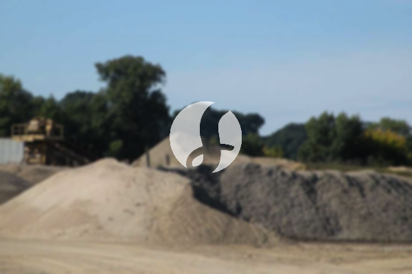

**Cara Memilih Pasir Halus untuk Plester yang Sesuai Kebutuhan** - Mitra, apakah Anda sedang mencari pasir halus berkualitas untuk pekerjaan plester di proyek Anda? Kami siap membantu menyediakan pasir halus terbaik dengan harga kompetitif dan pengiriman tepat waktu.



Plesteran yang kuat dan rapi adalah fondasi penting untuk finishing bangunan yang memuaskan. Kualitas pasir halus yang digunakan akan sangat memengaruhi hasil akhirnya. Nah, memilih jenis pasir halus yang tepat memang sedikit membingungkan. Yuk, kita bahas lebih lanjut!

## Memilih Pasir Halus yang Tepat untuk Plesteran

Mitra, ada beberapa hal yang perlu Anda perhatikan saat memilih pasir halus untuk plesteran. Tekstur, kandungan lumpur, dan ukuran butir adalah faktor penting. Pasir yang terlalu kasar bisa membuat plesteran retak, sementara pasir yang terlalu halus bisa menyebabkan plesteran menyusut dan lepas. Idealnya, Anda memerlukan pasir halus dengan gradasi yang seragam dan kandungan lumpur yang rendah.

Penting juga untuk memastikan pasir halus yang Anda beli bersih dari kotoran organik dan material anorganik lainnya. Kotoran tersebut dapat melemahkan daya rekat plesteran.  Kami sarankan, sebelum memutuskan jumlah yang dibutuhkan, sebaiknya Anda konsultasikan dengan tukang plester berpengalaman. Mereka bisa memberikan rekomendasi jenis pasir halus yang paling sesuai dengan jenis dinding dan kondisi cuaca di lokasi proyek Anda. Jangan ragu untuk [tanyakan harga](https://api.whatsapp.com/send?phone=6285776786091&text=*Halo%20sumbermaterial.com*%20%3A) ke Kami untuk mendapatkan penawaran terbaik!

## Jenis Pasir Halus yang Kami Sediakan untuk Plesteran

Sumber Material menyediakan berbagai jenis pasir halus yang cocok untuk plesteran. Kami memiliki pasir halus alami yang berasal dari sungai, serta pasir halus hasil pemecahan batu (split).

- **Pasir Halus Alami:** Pasir ini memiliki butiran yang lebih bulat dan halus, sehingga mudah tercampur dengan semen dan kapur. Cocok untuk plesteran dinding interior dan eksterior. Kami menyediakan pasir halus alami dengan ukuran butir yang seragam dan kandungan lumpur yang rendah, sesuai standar SNI.
- **Pasir Halus Split:** Pasir ini memiliki butiran yang lebih tajam dan kuat, sehingga menghasilkan plesteran yang lebih tahan lama. Cocok untuk plesteran dinding yang membutuhkan kekuatan ekstra, seperti dinding kamar mandi atau dapur.

Kami juga menyediakan pasir halus dalam berbagai ukuran kemasan, mulai dari 1 m3 hingga truk engkel penuh. Kami siap memenuhi kebutuhan proyek Mitra Sumber Material, baik proyek kecil maupun besar. Pastikan Anda memilih jenis pasir halus yang paling sesuai dengan kebutuhan proyek Anda. Untuk informasi lebih detail mengenai spesifikasi dan ketersediaan, jangan sungkan untuk bertanya kepada tim Kami.

## Mengapa Memesan Pasir Halus di Sumber Material?

Mitra, ada beberapa alasan mengapa memilih Sumber Material untuk kebutuhan pasir halus Anda adalah keputusan yang tepat. Pertama, Kami menjamin kualitas pasir halus yang Kami jual. Kami hanya bekerja sama dengan supplier terpercaya yang menghasilkan pasir halus berkualitas tinggi. Kedua, Kami menawarkan harga yang kompetitif dan transparan. Anda bisa minta penawaran harga langsung ke Kami dan bandingkan dengan supplier lain.

Ketiga, Kami menyediakan layanan pengiriman yang cepat dan tepat waktu. Kami melayani pengiriman ke seluruh wilayah Jabodetabek dan sekitarnya. Keempat, Kami memiliki stok yang selalu tersedia untuk memenuhi kebutuhan proyek Anda. Kelima, Kami siap membantu Anda menghitung kebutuhan pasir halus yang tepat untuk proyek Anda, sehingga Anda tidak perlu khawatir kelebihan atau kekurangan material.  Kami juga menyediakan jasa urug dan jasa cor jika Mitra membutuhkan.

## Pesan Pasir Halus Sekarang Juga!

Jangan tunda kebutuhan proyek Mitra Sumber Material — tanyakan harga dan ketersediaannya sekarang lewat tombol **WhatsApp** atau **Telepon** di bawah halaman ini.

ARTIKEL_SELESAI

## Menghitung Kebutuhan Pasir Halus untuk Proyek Plesteran Anda

Mitra, seringkali kita kesulitan memperkirakan berapa banyak pasir halus yang dibutuhkan untuk sebuah proyek plesteran. Kesalahan perhitungan bisa menyebabkan pemborosan material atau justru kekurangan di tengah pekerjaan. Nah, Kami akan bantu dengan contoh perhitungan sederhana.

Anggaplah Anda akan melakukan plesteran pada dinding dengan luas 100 meter persegi, dengan ketebalan plesteran 1,5 cm (0,015 meter). Pertama, hitung volume plesteran yang dibutuhkan: 100 m² x 0,015 m = 1,5 m³.

Untuk campuran plesteran standar, biasanya digunakan perbandingan 1 bagian semen : 3 bagian pasir halus. Ini berarti, dari total 1,5 m³ campuran, sekitar 0,375 m³ adalah semen dan sisanya, 1,125 m³ adalah pasir halus. Angka 0,375 m³ ini didapatkan dari 1,5 m³ / (1+3) = 0,375 m³.  Jadi, Anda akan membutuhkan sekitar 1,125 m³ pasir halus untuk proyek tersebut.

## Pertanyaan Umum Seputar Pasir Halus untuk Plesteran

Banyak Mitra Sumber Material yang bertanya seputar pasir halus. Berikut beberapa pertanyaan yang sering Kami terima:

### Berapa perbedaan antara pasir Pasang dan pasir halus untuk plesteran?

Pasir Pasang umumnya lebih kasar dan mengandung lebih banyak lumpur daripada pasir halus untuk plesteran. Pasir Pasang lebih cocok untuk pekerjaan pondasi dan lantai kerja, sementara pasir halus khusus didesain untuk menghasilkan plesteran yang lebih halus dan kuat.

### Apakah pasir halus bisa dicampur dengan jenis pasir lain?

Secara teknis bisa, tapi tidak disarankan. Mencampur jenis pasir yang berbeda dapat mengurangi kualitas plesteran dan meningkatkan risiko retak atau lepas. Sebaiknya gunakan satu jenis pasir halus yang konsisten untuk seluruh area plesteran.

### Bagaimana cara mengetahui kualitas pasir halus yang baik?

Perhatikan teksturnya. Pasir halus yang baik memiliki butiran yang seragam dan bersih dari kotoran organik. Coba remas sedikit pasir tersebut di tangan. Jika pasir mudah menyatu dan terasa licin, itu menandakan kandungan lumpurnya tinggi dan kualitasnya kurang baik.

### Apakah pasir halus yang terlalu halus juga bisa bermasalah?

Ya, pasir halus yang terlalu halus dapat menyebabkan plesteran menyusut dan retak karena kurangnya daya ikat. Idealnya, pilih pasir halus dengan gradasi yang tepat, tidak terlalu kasar dan tidak terlalu halus.

## Hindari Kesalahan Umum Saat Memesan Pasir Halus

Mitra, ada beberapa kesalahan umum yang sering terjadi saat memesan pasir halus. Salah satunya adalah tidak memperhatikan kualitas pasir. Banyak yang hanya fokus pada harga murah, tanpa mempedulikan kualitas material. Padahal, pasir halus yang berkualitas buruk dapat merusak hasil plesteran Anda.

Kesalahan lainnya adalah memesan pasir halus dalam jumlah yang tidak tepat. Terlalu sedikit dapat menghambat kelancaran pekerjaan, sementara terlalu banyak dapat membuang-buang anggaran. Pastikan Anda menghitung kebutuhan pasir halus dengan cermat sebelum melakukan pemesanan.

Selain itu, jangan lupa untuk memastikan supplier pasir halus yang Anda pilih memiliki reputasi yang baik dan dapat diandalkan. Pilih supplier yang dapat menjamin kualitas material dan pengiriman yang tepat waktu. Kami di Sumber Material selalu mengutamakan kualitas dan kepuasan pelanggan.

## Memahami Pengaruh Ukuran Butir Pasir Halus Terhadap Hasil Plesteran

Mitra, ukuran butir pasir halus memang berpengaruh signifikan terhadap hasil plesteran. Terlalu kasar, plesteran mudah retak karena butiran tidak mengisi celah dengan sempurna. Terlalu halus, daya rekatnya berkurang dan plesteran bisa mengelupas. Kami merekomendasikan pasir halus dengan ukuran butir antara 0,05 mm hingga 0,5 mm untuk hasil optimal. Ukuran ini memberikan keseimbangan antara daya rekat dan kemampuan mengisi celah.

## Pertanyaan Lain yang Sering Kami Terima

Mitra Sumber Material seringkali punya pertanyaan spesifik. Berikut beberapa di antaranya:

### Apakah pasir halus perlu dicuci sebelum digunakan?

Sebaiknya ya. Mencuci pasir halus menghilangkan kotoran dan lumpur yang dapat mengurangi kualitas plesteran. Namun, pastikan pasir dikeringkan dengan baik setelah dicuci.

### Berapa lama waktu yang dibutuhkan agar plesteran benar-benar kering?

Waktu pengeringan tergantung pada cuaca dan ketebalan plesteran. Umumnya, dibutuhkan 28 hari untuk plesteran benar-benar mengeras dan mencapai kekuatan maksimal.

### Apa yang harus dilakukan jika plesteran retak setelah kering?

Retakan kecil bisa diperbaiki dengan menambal menggunakan campuran semen dan pasir halus. Untuk retakan yang lebih besar, sebaiknya konsultasikan dengan tukang plester profesional.

## Tips Tambahan untuk Plesteran yang Awet dan Rapi

Selain memilih pasir halus yang tepat, ada beberapa tips tambahan yang bisa Anda terapkan. Pertama, pastikan dinding yang akan diplester bersih dari debu dan kotoran. Kedua, gunakan campuran plesteran yang sesuai dengan jenis dinding dan kondisi cuaca. Ketiga, aplikasikan plesteran secara merata dan hindari ketebalan yang berlebihan. Keempat, lakukan penyiraman secara berkala selama proses pengeringan untuk mencegah retak. Dengan mengikuti tips ini, Anda bisa mendapatkan hasil plesteran yang awet, kuat, dan rapi.
