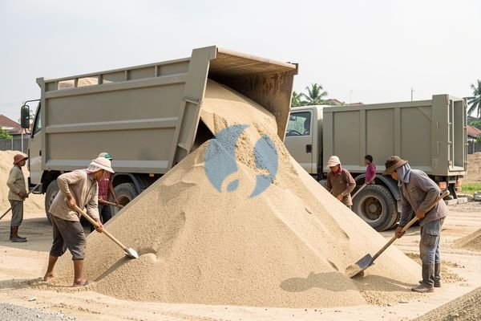

**Penjual Pasir Terdekat? Cek Dulu Hal Ini** - Mitra Sumber Material yang kami hormati, apakah Anda sedang merencanakan pembangunan rumah, renovasi, atau proyek konstruksi lainnya di Jabodetabek? Mencari penjual pasir terdekat yang bisa diandalkan, kualitasnya terjamin, dan harganya bersaing bisa jadi tantangan tersendiri. Nah, di sini Kami hadir untuk mempermudah Anda! Kami dari Sumber Material siap menyediakan berbagai jenis pasir dengan kualitas terbaik, langsung dikirim ke lokasi proyek Anda.



Seringkali, kontraktor atau pemilik rumah kesulitan menemukan penjual pasir yang benar-benar bisa memenuhi kebutuhan spesifik proyek. Mulai dari jenis pasir yang tepat, volume yang akurat, hingga pengiriman yang tepat waktu. Belum lagi urusan harga yang bisa berbeda-beda di setiap tempat. Tidak perlu khawatir lagi, Mitra! Kami akan bantu Anda menemukan solusi terbaik, termasuk memberikan penawaran harga yang jelas dan transparan.

## Memilih Penjual Pasir Terdekat yang Tepat: Apa yang Perlu Diperhatikan?

Ketika mencari penjual pasir terdekat, ada beberapa hal penting yang perlu Anda perhatikan. Pertama, pastikan penjual tersebut menyediakan jenis pasir yang sesuai dengan kebutuhan proyek Anda. Ada pasir urug, pasir pasang, pasir cor, dan lain-lain, masing-masing memiliki karakteristik dan kegunaan yang berbeda. Kedua, perhatikan kualitas pasirnya. Pastikan pasir yang Anda dapatkan bersih, bebas dari kotoran, dan memiliki ukuran butiran yang sesuai standar. Ketiga, bandingkan harga dari beberapa penjual untuk mendapatkan penawaran terbaik. Jangan lupa, harga termurah tidak selalu menjadi pilihan terbaik jika kualitasnya tidak terjamin.

Nah, untuk kemudahan Anda, Kami di Sumber Material menyediakan berbagai jenis pasir berkualitas dengan harga yang kompetitif. Anda bisa langsung [tanyakan harga terbaru](https://api.whatsapp.com/send?phone=6285776786091&text=*Halo%20sumbermaterial.com*%20%3A) dan mendapatkan penawaran khusus untuk proyek Anda. Kami memahami betul bagaimana pentingnya memilih material yang tepat untuk keberhasilan proyek Anda.

## Jenis Pasir yang Tersedia di Sumber Material dan Kegunaannya

Kami menyediakan berbagai jenis pasir untuk memenuhi kebutuhan proyek Anda, antara lain:

- **Pasir Urug:** Cocok untuk pengurugan lahan, pembuatan pondasi, dan pekerjaan landscaping. Pasir urug yang Kami jual memiliki kandungan lumpur yang rendah dan ukuran butiran yang bervariasi.
- **Pasir Pasang:** Ideal untuk pekerjaan pemasangan keramik, batu alam, dan lantai. Pasir pasang memiliki tekstur yang halus dan bersih, sehingga memudahkan proses pemasangan.
- **Pasir Cor:** Digunakan sebagai campuran dalam pembuatan beton. Pasir cor yang Kami sediakan memiliki kekuatan dan daya tahan yang tinggi, sehingga menghasilkan beton berkualitas.
- **Pasir Putih:** Sering digunakan untuk keperluan estetika, seperti pembuatan taman, kolam renang, atau dekorasi. Pasir putih yang Kami jual memiliki warna yang cerah dan tekstur yang lembut.

Butuh jenis pasir khusus yang tidak tercantum di atas? Jangan ragu untuk menghubungi Kami, Kami akan bantu mencarikan solusi terbaik. Kami juga menyediakan jasa konsultasi gratis untuk membantu Anda memilih jenis pasir yang paling sesuai dengan kebutuhan proyek Anda.

## Keuntungan Memesan Pasir di Sumber Material: Harga Jelas, Kualitas Terjamin

Mengapa Anda harus memilih Sumber Material sebagai penjual pasir terdekat Anda? Pertama, Kami menawarkan harga yang jelas dan transparan. Anda bisa langsung kirim kebutuhan dan lokasi proyek Anda lewat WhatsApp, dan Kami akan bantu hitungkan biaya totalnya secara rinci. Kedua, Kami menjamin kualitas pasir yang Kami jual. Pasir yang Kami sediakan telah melalui proses pemilihan dan pengujian yang ketat, sehingga Anda bisa yakin mendapatkan material berkualitas terbaik. Ketiga, Kami melayani pengiriman ke seluruh wilayah Jabodetabek dan sekitarnya. Kami punya armada pengiriman yang handal dan siap mengantarkan pesanan Anda tepat waktu.

Selain itu, Kami juga menawarkan berbagai kemudahan lainnya, seperti:

- **Pemesanan Mudah:** Anda bisa memesan pasir secara online melalui website Kami atau langsung menghubungi Kami melalui telepon atau WhatsApp.
- **Pengiriman Cepat:** Kami akan segera memproses pesanan Anda dan mengirimkannya secepat mungkin.
- **Layanan Pelanggan Ramah:** Tim layanan pelanggan Kami siap membantu Anda dengan pertanyaan atau masalah apa pun yang Anda hadapi.

## Cara Pemesanan Pasir di Sumber Material: Mudah dan Cepat

Memesan pasir di Sumber Material sangat mudah dan cepat. Anda bisa mengikuti langkah-langkah berikut:

1.  **Hubungi Kami:** Telepon atau WhatsApp Kami untuk mendapatkan penawaran harga dan informasi lebih lanjut.
2.  **Sampaikan Kebutuhan Anda:** Beritahu Kami jenis pasir yang Anda butuhkan, volume yang Anda pesan, dan lokasi pengiriman.
3.  **Konfirmasi Pesanan:** Setelah Kami menerima pesanan Anda, Kami akan segera memprosesnya dan mengirimkannya ke lokasi proyek Anda.

## Menghitung Kebutuhan Pasir untuk Proyek Anda: Contoh Praktis

Seringkali, Mitra Sumber Material mengalami kesulitan dalam menentukan berapa banyak pasir yang dibutuhkan untuk proyek mereka. Salah perhitungan bisa berakibat pada kekurangan material di tengah pekerjaan, atau justru kelebihan yang membuang-buang anggaran. Nah, Kami akan berikan contoh perhitungan sederhana untuk membantu Anda memperkirakan kebutuhan pasir.

Misalnya, Anda akan membuat lantaian beton untuk area seluas 50 meter persegi dengan ketebalan 10 cm (0,1 meter). Untuk menghitung volume pasir yang dibutuhkan, Anda perlu memperhitungkan campuran beton yang umum digunakan. Katakanlah, campuran beton yang akan Anda gunakan adalah 1:2:3 (semen:pasir:kerikil). Artinya, untuk setiap 1 bagian semen, dibutuhkan 2 bagian pasir dan 3 bagian kerikil.

## Pertanyaan Umum Seputar Pasir Bangunan: Kami Jawab!

Banyak pertanyaan yang sering Kami terima dari Mitra Sumber Material mengenai pasir bangunan. Berikut beberapa pertanyaan umum dan jawabannya:

### Apa Perbedaan Pasir Urug dan Pasir Pasang?

Pasir urug umumnya memiliki butiran yang lebih kasar dan kotor, cocok untuk pengurugan dan pekerjaan yang tidak memerlukan kerapihan tinggi. Sementara itu, pasir pasang bertekstur lebih halus dan bersih, ideal untuk pekerjaan yang membutuhkan presisi seperti pemasangan keramik.

### Bagaimana Cara Mengetahui Kualitas Pasir yang Baik?

Pasir yang baik seharusnya bersih dari kotoran organik, lumpur, atau material asing lainnya. Ambil segenggam pasir dan perhatikan apakah ada banyak tanah liat atau sampah. Pasir yang bersih akan terasa lebih berat dan memiliki warna yang seragam.

### Apakah Pasir Bisa Disimpan Terlalu Lama?

Pasir sebenarnya tidak memiliki tanggal kedaluwarsa, tetapi sebaiknya disimpan di tempat yang kering dan terlindung dari hujan. Jika terkena air, pasir bisa menggumpal dan sulit digunakan.

### Bagaimana Jika Saya Tidak Yakin Jenis Pasir yang Dibutuhkan?

Jangan ragu untuk menghubungi Kami! Tim Kami akan dengan senang hati membantu Anda memilih jenis pasir yang paling sesuai dengan kebutuhan proyek Anda.

## Hindari Kesalahan Umum Saat Memesan Pasir

Ada beberapa kesalahan umum yang sering dilakukan saat memesan pasir. Salah satunya adalah memesan volume yang tidak sesuai dengan kebutuhan. Penting untuk menghitung kebutuhan pasir secara akurat sebelum memesan agar tidak terjadi kekurangan atau kelebihan. Kesalahan lainnya adalah tidak memperhatikan kualitas pasir. Pastikan Anda memilih penjual yang terpercaya dan menyediakan pasir berkualitas. Selain itu, jangan lupa untuk mempertimbangkan biaya pengiriman dan waktu pengiriman. Pastikan penjual pasir bisa mengantarkan pesanan Anda tepat waktu dan sesuai dengan anggaran Anda. Dengan menghindari kesalahan-kesalahan ini, Anda bisa memastikan proyek Anda berjalan lancar dan efisien.

## Memastikan Pasir yang Anda Terima Sesuai Standar SNI

Mitra Sumber Material, kualitas pasir sangat berpengaruh pada kekuatan dan durabilitas bangunan Anda. Kami selalu memastikan pasir yang Kami jual memenuhi standar SNI (Standar Nasional Indonesia) yang berlaku. Namun, ada baiknya Anda juga mengetahui sedikit tentang standar tersebut. SNI mengatur berbagai aspek pasir, mulai dari ukuran butiran, kandungan lumpur, hingga kekuatan tekan. Dengan memastikan pasir yang Anda gunakan memenuhi standar SNI, Anda bisa lebih yakin bahwa bangunan Anda akan aman dan tahan lama.

## Contoh Perhitungan Kebutuhan Pasir: Pekerjaan Plesteran

Untuk memberikan gambaran yang lebih jelas, mari kita hitung kebutuhan pasir untuk pekerjaan plesteran dinding seluas 100 meter persegi dengan tebal plesteran 1,5 cm (0,015 meter). Umumnya, campuran plesteran yang digunakan adalah 1:3 (semen:pasir). Ini berarti, untuk setiap 1 bagian semen, dibutuhkan 3 bagian pasir.

### Menghitung Volume Plesteran

Volume plesteran = Luas dinding x Tebal plesteran = 100 m² x 0,015 m = 1,5 m³.

### Menghitung Volume Pasir

Karena perbandingan semen:pasir adalah 1:3, maka volume pasir yang dibutuhkan adalah 3/4 dari total volume plesteran. Volume pasir = (3/4) x 1,5 m³ = 1,125 m³. Jadi, Anda membutuhkan sekitar 1,125 meter kubik pasir untuk pekerjaan plesteran tersebut. Perlu diingat, ini adalah perhitungan estimasi, dan sebaiknya Anda selalu menambahkan sedikit cadangan untuk mengantisipasi kehilangan material selama proses pengerjaan.

## Apa yang Harus Dilakukan Jika Pasir yang Diterima Tidak Sesuai?

Terkadang, meski sudah berhati-hati, Mitra Sumber Material mungkin menerima pasir yang tidak sesuai dengan harapan. Jika hal ini terjadi, jangan ragu untuk segera menghubungi Kami. Kami akan dengan senang hati membantu menyelesaikan masalah tersebut.

### Apa yang Harus Dilakukan Jika Pasir Terlalu Banyak Kotoran?

Segera informasikan kepada tim Kami, dan Kami akan segera melakukan penggantian.

### Bagaimana Jika Volume Pasir Kurang dari yang Dipesan?

Kami akan segera mengirimkan kekurangan tersebut tanpa biaya tambahan.

### Apakah Bisa Mengembalikan Pasir Jika Tidak Terpakai?

Kebijakan pengembalian Kami akan Kami jelaskan secara detail saat Anda menghubungi Kami.

Mau tahu harga terbaru untuk kebutuhan proyek Mitra Sumber Material? Klik tombol **WhatsApp** atau **Telepon** di bawah, kirim kebutuhan dan lokasi proyek, Kami bantu hitungkan.
