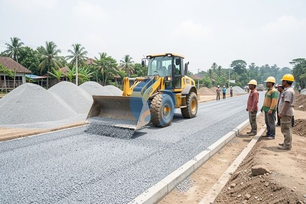

**Cara Memilih Perbedaan Base Course A dan B yang Sesuai Kebutuhan** - Mitra Sumber Material yang kami hormati, apakah Anda sedang merencanakan pembangunan jalan, parkiran, atau fondasi bangunan dan bingung memilih antara base course A dan B? Memilih material yang tepat memang krusial agar hasil konstruksi tahan lama dan aman. Nah, Kami di Sumber Material siap membantu Anda memahami perbedaan keduanya dan menemukan solusi terbaik untuk proyek Anda.



## Memahami Kebutuhan Proyek Anda: Base Course A atau B?

Ketika berbicara tentang base course, Mitra Sumber Material, penting untuk memahami bahwa keduanya memiliki karakteristik dan kegunaan yang berbeda. Base course A umumnya digunakan untuk lapisan dasar jalan dan parkiran yang menerima beban ringan hingga sedang. Sementara itu, base course B lebih cocok untuk area yang menahan beban berat, seperti jalan raya, landasan pacu, atau fondasi bangunan bertingkat. Pemilihan yang tepat akan sangat memengaruhi daya tahan dan performa konstruksi Anda. Jangan sampai salah pilih, ya!

Untuk memudahkan Anda, Kami menawarkan layanan konsultasi gratis. Cukup kirimkan detail proyek Anda dan lokasi pengiriman ke nomor WhatsApp Kami, dan tim ahli Kami akan merekomendasikan material yang paling sesuai.

## Mengenal Lebih Dekat: Spesifikasi dan Penggunaan Base Course A dan B

Base course A dan B sama-sama merupakan lapisan antara subgrade (lapisan tanah dasar) dan lapisan permukaan (aspal atau beton). Perbedaan utamanya terletak pada komposisi material dan ukuran agregatnya. Base course A biasanya terdiri dari agregat batu pecah, pasir urug, dan material timbunan pilihan dengan gradasi yang lebih halus. Sedangkan base course B menggunakan agregat batu pecah yang lebih kasar dan kuat, seringkali dengan tambahan semen atau *fly ash* untuk meningkatkan stabilitas.

<table class="table">
  <caption>Perbandingan Spesifikasi Base Course A dan B</caption>
  <thead>
    <tr><th>Spesifikasi</th><th>Base Course A</th><th>Base Course B</th></tr>
  </thead>
  <tbody>
    <tr><td>Komposisi</td><td>Agregat, Pasir Urug, Material Timbunan</td><td>Agregat Batu Pecah, Semen/Fly Ash (opsional)</td></tr>
    <tr><td>Ukuran Agregat</td><td>Gradasi Halus (0-25mm)</td><td>Gradasi Kasar (25-50mm atau lebih besar)</td></tr>
    <tr><td>Kekuatan</td><td>Cukup Baik</td><td>Sangat Baik</td></tr>
    <tr><td>Aplikasi Umum</td><td>Jalan Lingkungan, Parkiran Rumah</td><td>Jalan Raya, Landasan Pacu, Fondasi Gedung</td></tr>
  </tbody>
</table>

Nah, dengan perbandingan ini, Anda bisa melihat bagaimana base course B lebih unggul dalam menahan beban berat karena agregatnya yang lebih besar dan kuat.

## Dapatkan Base Course A dan B Berkualitas dari Sumber Material

Kami di Sumber Material menyediakan base course A dan B dengan kualitas terjamin. Kami hanya menggunakan material pilihan dan memastikan proses produksi sesuai standar SNI. Untuk base course A, Kami menyediakan berbagai ukuran gradasi yang dapat disesuaikan dengan kebutuhan proyek Anda. Sedangkan untuk base course B, Kami menawarkan opsi dengan atau tanpa campuran semen/fly ash, tergantung pada tingkat kekuatan yang Anda butuhkan.

Anda tidak perlu repot mencari supplier lain. Di Sumber Material, Anda bisa mendapatkan base course A dan B dalam jumlah berapapun, mulai dari proyek kecil hingga skala besar. Kami juga melayani pengiriman ke seluruh wilayah Jabodetabek dan sekitarnya, termasuk Bogor, Jakarta, Bekasi, Karawang, Tangerang, dan Cikarang.

## Kemudahan Pemesanan Material Bangunan Bersama Kami

Mengapa memilih Sumber Material? Pertama, Kami menawarkan kemudahan pemesanan. Anda cukup kirimkan kebutuhan material dan lokasi proyek Anda melalui WhatsApp. Selanjutnya, Kami akan membantu menghitung volume material yang dibutuhkan dan memberikan penawaran harga terbaik. Kami juga akan mengatur pengiriman langsung ke lokasi proyek Anda. Kedua, Kami menjamin kualitas material yang Kami jual. Ketiga, Kami memberikan layanan konsultasi gratis untuk membantu Anda memilih material yang tepat.

Jangan tunda kebutuhan proyek Mitra Sumber Material — tanyakan harga dan ketersediaannya sekarang lewat tombol **WhatsApp** atau **Telepon** di bawah halaman ini.

ARTIKEL_SELESAI

## Menghitung Kebutuhan Base Course: Contoh Kasus Proyek Parkiran

Mitra Sumber Material, seringkali menghitung kebutuhan base course menjadi tantangan tersendiri. Nah, Kami akan berikan contoh perhitungan sederhana untuk membantu Anda memperkirakan volume yang dibutuhkan. Anggap saja Anda akan membuat parkiran berukuran 10 meter x 20 meter dengan ketebalan base course yang direncanakan 15 cm (0,15 meter).

## Tips Memilih Base Course yang Tepat: Hindari Kesalahan Umum

Mitra Sumber Material, ada beberapa kesalahan umum yang sering terjadi saat memilih base course. Salah satunya adalah memilih base course A untuk area yang menahan beban berat. Ini bisa menyebabkan kerusakan jalan atau parkiran dalam waktu singkat. Kesalahan lain adalah tidak memperhatikan kualitas material. Pastikan Anda membeli base course dari supplier terpercaya yang menjamin kualitas dan konsistensi materialnya.

Selain itu, perhatikan juga gradasi agregat. Gradasi yang tidak sesuai bisa menyebabkan base course menjadi kurang padat dan mudah berdebu. Pastikan gradasi agregat sesuai dengan spesifikasi yang direkomendasikan untuk jenis proyek Anda. Dan jangan lupa, selalu konsultasikan kebutuhan material Anda dengan ahli konstruksi sebelum memulai proyek.

## Pertanyaan Umum Seputar Base Course A dan B

Mitra Sumber Material, Kami sering menerima pertanyaan seputar base course A dan B. Berikut beberapa pertanyaan yang paling sering diajukan, beserta jawabannya:

### Berapa Ketebalan Ideal Base Course?

Ketebalan ideal base course tergantung pada jenis proyek dan beban yang akan ditahan. Untuk jalan lingkungan, ketebalan 10-15 cm biasanya sudah cukup. Namun, untuk jalan raya atau landasan pacu, ketebalan minimal 20 cm bahkan bisa lebih.

### Apakah Base Course B Lebih Mahal dari Base Course A?

Secara umum, ya. Base course B cenderung lebih mahal karena menggunakan material yang lebih berkualitas dan proses produksi yang lebih kompleks. Namun, investasi ini sebanding dengan daya tahan dan performa yang lebih baik dalam jangka panjang.

### Bisakah Base Course A Digunakan untuk Fondasi Bangunan?

Tidak disarankan. Base course A kurang kuat untuk menahan beban bangunan. Gunakan base course B atau material lain yang lebih sesuai untuk fondasi.

### Bagaimana Cara Memastikan Kualitas Base Course?

Periksa visual material. Base course yang baik harus memiliki gradasi yang seragam, bebas dari kotoran dan lumpur, serta memiliki kandungan air yang sesuai. Jika ragu, minta hasil uji laboratorium dari supplier.

## Memperhatikan Kondisi Tanah Dasar: Pengaruhnya pada Pemilihan Base Course

Mitra Sumber Material, pemilihan base course A atau B tidak bisa dilakukan secara terpisah dari kondisi tanah dasar di lokasi proyek Anda. Tanah dasar yang buruk, misalnya tanah lempung yang mudah mengembang susut, memerlukan base course yang lebih kuat dan stabil – dalam banyak kasus, base course B adalah pilihan yang lebih tepat. Sebaliknya, jika tanah dasarnya sudah cukup padat dan stabil, base course A mungkin sudah mencukupi.

### Menguji Daya Dukung Tanah Dasar

Sebelum menentukan jenis base course, ada baiknya melakukan uji daya dukung tanah dasar. Uji ini akan memberikan informasi tentang kemampuan tanah menahan beban. Hasilnya akan membantu Anda menentukan ketebalan base course yang dibutuhkan, dan apakah perlu dilakukan perbaikan tanah dasar sebelum pemasangan base course. Kami bisa merekomendasikan jasa kontraktor terpercaya untuk melakukan uji daya dukung tanah dasar di wilayah Jabodetabek dan sekitarnya.

## Menghindari Kesalahan Pemesanan: Spesifikasi yang Perlu Diperhatikan

Mitra Sumber Material, seringkali kesalahan pemesanan terjadi karena kurang teliti dalam memperhatikan spesifikasi material. Saat memesan base course A, pastikan Anda mengetahui gradasi agregat yang digunakan. Apakah sesuai dengan standar yang Anda butuhkan? Apakah ada batasan maksimal kadar lumpur atau kotoran? Hal yang sama berlaku untuk base course B. Pastikan Anda mengetahui jenis semen atau *fly ash* yang digunakan, serta persentase campuran yang tepat.

### Perbedaan Ukuran Agregat: Dampaknya pada Pemadatan

Ukuran agregat yang berbeda akan memengaruhi proses pemadatan base course. Agregat yang terlalu halus akan sulit dipadatkan secara maksimal, sementara agregat yang terlalu kasar juga bisa menyulitkan pemadatan. Pastikan ukuran agregat yang Anda pilih sesuai dengan jenis alat pemadat yang akan digunakan. Kami dapat membantu Anda memilih ukuran agregat yang paling sesuai untuk proyek Anda.

### Pertanyaan yang Sering Diajukan Mengenai Base Course

Mitra Sumber Material, berikut beberapa pertanyaan yang sering Kami terima:

**Apakah base course bisa dipadatkan dengan alat manual?**

Pemadatan manual mungkin bisa dilakukan untuk proyek kecil dengan area terbatas. Namun, untuk proyek yang lebih besar, Kami sangat merekomendasikan penggunaan alat pemadat mekanis seperti *vibratory roller* untuk hasil yang lebih optimal.

**Bagaimana cara mengetahui apakah base course sudah dipadatkan dengan baik?**

Anda bisa melakukan uji kepadatan menggunakan alat uji kepadatan tanah. Atau, Anda bisa melihat secara visual – base course yang sudah dipadatkan dengan baik akan terlihat rata, padat, dan tidak mudah tergenang air.

**Apakah base course perlu disiram air sebelum dipadatkan?**

Ya, penyiraman air dapat membantu proses pemadatan, terutama jika material base course terasa kering. Namun, jangan menyiram terlalu banyak air karena bisa membuat material menjadi licin dan sulit dipadatkan.

Dengan memahami perbedaan, kebutuhan proyek, dan tips memilih yang tepat, Anda dapat memastikan fondasi atau jalan yang Anda bangun tahan lama dan aman. Jangan sungkan untuk menghubungi Kami jika Anda membutuhkan bantuan lebih lanjut. Kami siap membantu Anda mewujudkan proyek impian Anda!
