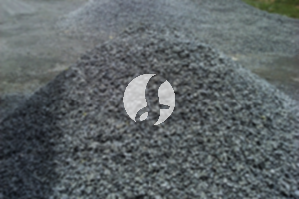

**Quarry Batu Split Terdekat untuk Renovasi dan Bangunan Baru** - Mitra, pernahkah Anda mengalami kesulitan mencari batu split berkualitas dengan cepat dan mudah? Banyak proyek tersendat karena ketersediaan material yang tidak pasti, pengiriman terlambat, atau harga yang tidak sesuai harapan. Kami di Sumber Material memahami betul tantangan ini. Kami hadir untuk memastikan proyek Mitra berjalan lancar dengan menyediakan batu split terdekat, siap kirim ke lokasi proyek Anda.



## Memilih Batu Split yang Tepat: Ukuran dan Mutu yang Perlu Anda Perhatikan

Batu split adalah material konstruksi penting yang digunakan dalam berbagai aplikasi, mulai dari pondasi, drainase, hingga lapisan dasar jalan. Memilih jenis yang tepat sangat krusial agar hasil akhir proyek Anda kuat dan tahan lama. Ada beberapa faktor yang perlu dipertimbangkan, yaitu ukuran dan mutu batu split. Ukuran batu split umumnya bervariasi, mulai dari 5/20 mm, 10/20 mm, hingga 20/40 mm. Pemilihan ukuran bergantung pada kebutuhan proyek Anda. Misalnya, untuk pondasi membutuhkan ukuran yang lebih besar untuk kekuatan yang lebih baik, sementara untuk drainase ukuran yang lebih kecil lebih disarankan. Mutu batu split juga penting, pastikan material yang Anda gunakan memenuhi standar SNI agar kualitasnya terjamin. Nah, daripada bingung mencari sendiri, Kami bisa membantu Anda memilih batu split yang paling sesuai dengan spesifikasi proyek. Cukup beritahu Kami detail proyek Anda, dan Kami akan memberikan rekomendasi terbaik.

## Jenis Batu Split yang Tersedia di Sumber Material

Kami menyediakan berbagai jenis batu split dengan ukuran dan mutu yang bervariasi untuk memenuhi kebutuhan proyek Anda. Beberapa pilihan yang tersedia antara lain:

- **Batu Split 5/20 mm:** Ideal untuk pondasi rumah, jalan setapak, dan lapisan dasar bangunan. Kekuatan dan kepadatan yang baik memastikan bangunan Anda kokoh dan stabil.
- **Batu Split 10/20 mm:** Cocok digunakan untuk campuran beton, drainase, dan urugan. Ukurannya yang sedang memberikan keseimbangan antara kekuatan dan fleksibilitas.
- **Batu Split 20/40 mm:** Sering digunakan untuk drainase besar, stabilisasi jalan, dan pondasi bangunan bertingkat. Ukurannya yang lebih besar memberikan kekuatan dan daya tahan yang maksimal.
- **Batu Split Andesit:** Jenis batu split yang populer karena kekuatannya yang tinggi dan daya tahannya terhadap cuaca ekstrem. Cocok untuk proyek-proyek yang membutuhkan material berkualitas tinggi.
- **Batu Split Cadas:** Pilihan ekonomis untuk proyek-proyek skala kecil atau menengah. Meskipun relatif lebih murah, batu split cadas tetap memiliki kekuatan yang cukup untuk berbagai aplikasi konstruksi.

Untuk proyek jalan, misalnya, penggunaan batu split 20/40 mm sebagai subbase akan meningkatkan daya dukung jalan dan mencegah terjadinya kerusakan akibat beban berat. Sementara untuk pondasi rumah, kombinasi batu split 5/20 mm dan 10/20 mm akan memberikan kekuatan dan stabilitas yang optimal. Kami siap membantu Anda menghitung kebutuhan material yang tepat untuk proyek Anda.

## Mengapa Memesan Batu Split di Sumber Material?

Mitra, kenapa harus repot mencari batu split ke mana-mana kalau Anda bisa mendapatkan semuanya di Sumber Material? Kami bukan sekadar supplier material bangunan biasa. Kami memahami betul betapa pentingnya ketepatan waktu dan kualitas material dalam setiap proyek. Beberapa alasan kenapa Anda harus memesan batu split di Kami:

- **Ketersediaan Stok Terjamin:** Kami selalu memastikan stok batu split tersedia dalam jumlah yang cukup untuk memenuhi kebutuhan proyek Anda, bahkan yang mendesak sekalipun.
- **Pengiriman Cepat dan Tepat Waktu:** Kami melayani pengiriman ke seluruh wilayah Jabodetabek dan sekitarnya. Kami berkomitmen untuk mengirimkan pesanan Anda tepat waktu, sehingga proyek Anda tidak terlambat selesai.
- **Harga Bersaing:** Kami menawarkan harga batu split yang kompetitif tanpa mengorbankan kualitas. Dengan Kami, Anda mendapatkan nilai terbaik untuk setiap rupiah yang Anda keluarkan.
- **Kualitas Terjamin:** Kami hanya menyediakan batu split yang memenuhi standar SNI. Kami memastikan setiap material yang Kami suplai berkualitas tinggi dan tahan lama.
- **Layanan Konsultasi Gratis:** Tim ahli Kami siap memberikan konsultasi gratis untuk membantu Anda memilih batu split yang paling sesuai dengan kebutuhan proyek Anda.
- **Berlokasi Strategis:** Dengan gudang yang tersebar di Bogor, Jakarta, Bekasi, Karawang, Tangerang, dan Cikarang, Kami bisa menjangkau lokasi proyek Anda dengan cepat dan efisien.

## Pesan Batu Split Sekarang Juga: Mudah, Cepat, dan Terpercaya

Memesan batu split di Sumber Material sangat mudah. Anda bisa langsung menghubungi Kami melalui tombol **WhatsApp** atau **Telepon** yang tersedia di halaman ini. Beritahu Kami kebutuhan Anda, termasuk jenis batu split, ukuran, dan lokasi proyek. Tim Kami akan segera memproses pesanan Anda dan memberikan penawaran harga terbaik. Jangan tunda lagi, pastikan proyek Anda berjalan lancar dengan batu split berkualitas dari Sumber Material!

## Perbandingan Batu Split Andesit dan Cadas: Mana yang Lebih Cocok untuk Proyek Anda?

Mitra Sumber Material seringkali bingung memilih antara batu split andesit dan cadas. Keduanya memiliki kelebihan dan kekurangan masing-masing. Untuk membantu Anda memutuskan, berikut perbandingan singkatnya:

- **Kekuatan:** Andesit memiliki kekuatan tekan yang lebih tinggi dibandingkan cadas, sehingga lebih cocok untuk proyek yang membutuhkan daya tahan ekstra, seperti jalan raya atau struktur bangunan berat.
- **Daya Serap Air:** Cadas cenderung lebih mudah menyerap air dibandingkan andesit. Hal ini bisa menjadi pertimbangan jika proyek Anda berada di daerah dengan curah hujan tinggi.
- **Harga:** Secara umum, batu split cadas lebih ekonomis dibandingkan andesit. Ini bisa menjadi faktor penting jika anggaran proyek Anda terbatas.
- **Ketersediaan:** Ketersediaan batu split andesit mungkin lebih terbatas di beberapa daerah dibandingkan cadas.

Secara ringkas, jika kekuatan dan daya tahan adalah prioritas utama, andesit adalah pilihan yang lebih baik. Namun, jika anggaran terbatas dan proyek Anda tidak membutuhkan kekuatan ekstra, cadas bisa menjadi alternatif yang tepat. Jangan ragu untuk bertanya kepada Kami jika Anda masih bingung menentukan pilihan terbaik.

## Pertanyaan Umum Tentang Batu Split: Seputar Pemesanan dan Pengiriman

Kami sering menerima pertanyaan serupa dari Mitra Sumber Material. Berikut beberapa pertanyaan yang paling umum dan jawabannya:

### Berapa Lama Waktu Pengiriman?

Waktu pengiriman tergantung pada lokasi proyek Anda dan ketersediaan stok. Untuk wilayah Jabodetabek, biasanya Kami bisa mengirimkan pesanan dalam 1-3 hari kerja.

### Apakah Bisa Memesan dalam Jumlah Kecil?

Tentu saja! Kami melayani pemesanan dalam jumlah kecil maupun besar. Tidak ada batasan minimum order.

### Bagaimana Cara Memastikan Kualitas Batu Split?

Kami hanya menyediakan batu split yang memenuhi standar SNI. Selain itu, Kami juga melakukan pemeriksaan kualitas secara berkala untuk memastikan material yang Kami suplai selalu dalam kondisi terbaik.

### Apakah Ada Biaya Tambahan untuk Pengiriman?

Biaya pengiriman akan Kami informasikan setelah mengetahui lokasi proyek Anda dan jumlah pesanan. Kami akan memberikan penawaran yang transparan dan kompetitif.

## Menghitung Kebutuhan Batu Split: Contoh Kasus Proyek Drainase

Mitra, seringkali sulit memperkirakan berapa banyak batu split yang dibutuhkan untuk sebuah proyek. Salah perhitungan bisa mengakibatkan kekurangan material yang memperlambat pekerjaan, atau kelebihan material yang berarti pemborosan biaya. Mari kita ambil contoh kasus sederhana: Anda akan membuat drainase sepanjang 20 meter dengan lebar 0,5 meter dan kedalaman 0,3 meter. Asumsikan Anda menggunakan batu split ukuran 20/40 mm.

## Tips Memilih Supplier Batu Split Terpercaya

Memilih supplier yang tepat sama pentingnya dengan memilih material berkualitas. Ada beberapa hal yang perlu diperhatikan, Mitra. Pertama, pastikan supplier memiliki reputasi baik dan pengalaman yang cukup di bidang ini. Kedua, periksa apakah supplier tersebut menyediakan material yang sesuai dengan standar SNI. Ketiga, pastikan supplier memiliki sistem pengiriman yang efisien dan terpercaya. Keempat, jangan ragu untuk membandingkan harga dari beberapa supplier sebelum membuat keputusan. Dengan memilih supplier yang tepat, Anda bisa mendapatkan material berkualitas dengan harga yang kompetitif dan pengiriman yang tepat waktu. Kami di Sumber Material mengutamakan kepuasan pelanggan dan selalu berusaha memberikan layanan terbaik.

## Pertanyaan Lain yang Sering Muncul dari Mitra Kami

### Apakah Batu Split Perlu Dicuci Sebelum Digunakan?

Sebaiknya dicuci, Mitra. Mencuci batu split akan menghilangkan debu dan kotoran yang menempel, sehingga meningkatkan daya rekat dengan material lain seperti semen atau aspal.

### Apa Bedanya Batu Split dengan Kerikil?

Batu split dihasilkan dari pemecahan batu besar menggunakan mesin *crusher*, menghasilkan bentuk yang lebih tajam dan bersudut. Kerikil biasanya berbentuk lebih bulat dan alami.

### Bagaimana Cara Menyimpan Batu Split Agar Tidak Tercemar?

Simpan batu split di tempat yang kering dan bersih, terlindung dari hujan dan lumpur. Tutup dengan terpal jika perlu.

### Bisakah Saya Mengunjungi Gudang Sumber Material untuk Melihat Langsung Kualitas Batu Splitnya?

Tentu saja, Mitra! Kami sangat menyambut kunjungan Anda. Hubungi Kami terlebih dahulu untuk mengatur jadwal kunjungan.

Mau tahu harga terbaru untuk kebutuhan proyek Mitra Sumber Material? Klik tombol **WhatsApp** atau **Telepon** di bawah, kirim kebutuhan dan lokasi proyek, Kami bantu hitungkan.
