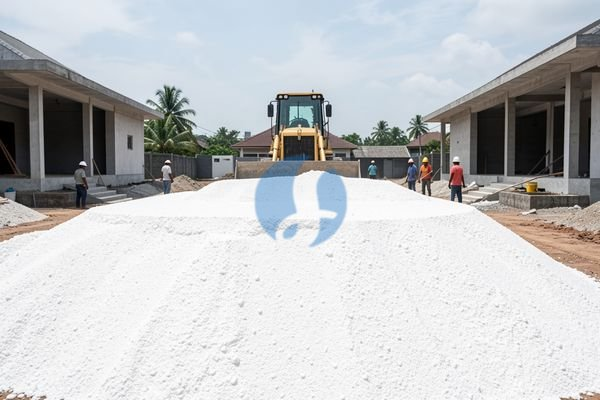

**Cara Memilih Tanah Sirtu Putih yang Sesuai Kebutuhan** - Mitra Sumber Material, ## Mengapa Tanah Sirtu Putih Jadi Pilihan Populer untuk Proyek Anda?



Banyak pertanyaan muncul saat menentukan material urug yang ideal, seperti “Apakah tanah sirtu putih cukup kuat untuk fondasi?” atau “Bagaimana cara memastikan kualitas tanah sirtu yang saya beli?”. Nah, tanah sirtu putih ini adalah campuran antara pasir, lumpur, dan sedikit lempung yang membuatnya stabil dan mudah dipadatkan. Ini menjadikannya pilihan populer untuk berbagai aplikasi konstruksi, terutama untuk urug bawah bangunan, pondasi, dan pembuatan jalan. Mitra, kami di Sumber Material menyediakan tanah sirtu putih berkualitas dengan berbagai ukuran butiran untuk memenuhi kebutuhan proyek Anda.

## Memilih Jenis Tanah Sirtu Putih yang Tepat: Ukuran dan Aplikasi

Ada beberapa jenis tanah sirtu putih yang tersedia, masing-masing dengan karakteristik yang berbeda. Perbedaan utamanya terletak pada ukuran butiran dan kandungan lumpurnya. Tanah sirtu putih dengan butiran kasar (lebih banyak pasir) biasanya lebih baik untuk drainase, sedangkan yang lebih halus (lebih banyak lumpur) lebih mudah dipadatkan. Anda bisa memilih varian yang paling sesuai dengan kebutuhan spesifik proyek Anda. Misalnya, untuk urug pondasi bangunan bertingkat, Anda memerlukan sirtu putih dengan daya padat tinggi. Kami menawarkan berbagai pilihan dengan gradasi yang sesuai standar SNI, memastikan kekuatan dan stabilitas yang optimal.

## Lengkap dengan Jasa Urug dan Sewa Alat Berat dari Sumber Material

Selain menyediakan material, Kami juga menawarkan jasa urug tanah sirtu putih dan sewa alat berat untuk mempermudah proyek Anda. Misalnya, Anda ingin mengurug lahan seluas 500 meter persegi dengan ketinggian 1 meter. Kami dapat menghitung kebutuhan sirtu putih secara akurat dan mengatur pengiriman langsung ke lokasi proyek Anda di wilayah Jabodetabek dan sekitarnya. Kami juga menyediakan jasa sewa ekskavator, bulldozer, dan alat berat lainnya untuk mempercepat proses pengerjaan. Dengan memesan material dan jasa dari Kami, Anda bisa menghemat waktu dan tenaga, serta memastikan pekerjaan urug dilakukan dengan profesional.

## Pesan Tanah Sirtu Putih dengan Mudah: Cukup Chat WhatsApp!

## Perhitungan Kebutuhan Tanah Sirtu Putih: Studi Kasus Proyek Rumah 2 Lantai

Seringkali, Mitra Sumber Material mengalami kesulitan memperkirakan volume tanah sirtu putih yang dibutuhkan untuk proyek. Nah, mari kita ambil contoh kasus rumah 2 lantai dengan luas bangunan 100 meter persegi dan tinggi pondasi 80 cm. Asumsikan area yang perlu diurug adalah seluas 120 meter persegi (termasuk area di sekitar bangunan). Pertama, hitung volume urugan dalam meter kubik: 120 m² x 0,8 m = 96 m³.

Namun, ini belum memperhitungkan faktor pemadatan. Tanah sirtu putih akan memadat setelah diratakan dan dipadatkan. Faktor pemadatan biasanya berkisar antara 1,1 hingga 1,3, tergantung pada jenis tanah dan metode pemadatan yang digunakan. Untuk perhitungan ini, kita gunakan faktor 1,2. Jadi, volume tanah sirtu putih yang perlu dipesan adalah: 96 m³ x 1,2 = 115,2 m³.

## Memahami Perbedaan Sirtu Putih, Sirtu Merah, dan Pasir Urug

Mitra, seringkali ada kebingungan antara tanah sirtu putih, sirtu merah, dan pasir urug. Ketiganya memang sering digunakan untuk urug, tapi memiliki karakteristik dan aplikasi yang berbeda. Sirtu merah memiliki kandungan lempung lebih tinggi dan cenderung lebih lengket, sehingga kurang ideal untuk pondasi bangunan besar karena potensi penyusutan yang lebih tinggi. Sementara itu, pasir urug umumnya lebih bersih dan berbutir kasar, sehingga drainasenya sangat baik, tetapi kurang mampu menahan beban berat.

Sirtu putih, dengan komposisi pasir, lumpur, dan lempung yang seimbang, menawarkan kombinasi kekuatan, stabilitas, dan drainase yang baik. Ini menjadikannya pilihan ideal untuk berbagai aplikasi, termasuk urug pondasi, pembuatan jalan setapak, dan penimbunan lahan. Kami di Sumber Material menyediakan ketiga jenis material ini, sehingga Anda bisa memilih yang paling sesuai dengan kebutuhan proyek Anda. Jangan ragu untuk berkonsultasi dengan tim Kami untuk mendapatkan rekomendasi terbaik.

### Pertanyaan yang Sering Diajukan (FAQ) tentang Tanah Sirtu Putih

Berikut beberapa pertanyaan yang sering Kami terima dari Mitra Sumber Material:

**### Apa perbedaan sirtu putih dengan sirtu kuning?**

Sirtu kuning biasanya memiliki kandungan organik yang lebih tinggi dan warna yang lebih gelap karena kandungan besi oksida. Sirtu putih lebih bersih dan memiliki warna yang lebih terang.

**### Apakah tanah sirtu putih bisa langsung digunakan tanpa pemadatan?**

Tidak, tanah sirtu putih perlu dipadatkan untuk mencapai kekuatan dan stabilitas yang optimal. Pemadatan dapat dilakukan dengan alat-alat seperti stamper atau vibrator.

**### Berapa lama waktu yang dibutuhkan untuk pemadatan tanah sirtu putih?**

Waktu pemadatan tergantung pada jenis tanah, metode pemadatan, dan kedalaman lapisan urugan. Umumnya, dibutuhkan beberapa lapis pemadatan untuk mencapai hasil yang maksimal.

**### Apakah tanah sirtu putih cocok untuk membuat jalan setapak?**

Ya, tanah sirtu putih sangat cocok untuk membuat jalan setapak karena memiliki daya tahan yang baik dan mudah dipadatkan. Namun, pastikan untuk menambahkan lapisan batu split atau agregat lain di atasnya untuk meningkatkan kekuatan dan daya tahan jalan setapak.

## Tips Memilih dan Memesan Tanah Sirtu Putih Berkualitas

Ketika memesan tanah sirtu putih, ada beberapa hal penting yang perlu diperhatikan. Pertama, pastikan material yang Anda terima memiliki warna putih bersih dan bebas dari sampah atau material organik. Kedua, perhatikan tekstur tanah. Tanah sirtu putih yang berkualitas memiliki tekstur yang seragam dan tidak terlalu berpasir atau berlumpur. Ketiga, tanyakan tentang sumber material dan proses pengolahan yang digunakan. Kami di Sumber Material hanya menyediakan tanah sirtu putih dari sumber yang terpercaya dan melalui proses pengolahan yang ketat untuk memastikan kualitasnya. Kirim kebutuhan dan lokasi proyek Anda lewat WhatsApp, dan Kami akan bantu memastikan Anda mendapatkan material terbaik untuk proyek Anda.

## Menghindari Kesalahan Umum Saat Membeli Tanah Sirtu Putih

Mitra, Kami sering menerima keluhan tentang kualitas tanah sirtu putih yang tidak sesuai harapan. Salah satu kesalahan paling umum adalah tidak memeriksa kandungan lumpur dan pasir secara visual. Tanah sirtu putih yang terlalu banyak lumpurnya akan sulit dipadatkan dan rentan retak saat kering. Sebaliknya, yang terlalu berpasir akan kurang kuat dan mudah terbawa air. Pastikan Anda mendapatkan sampel sebelum memesan dalam jumlah besar dan perhatikan apakah ada banyak batu kerikil atau sampah organik di dalamnya.

## Perbandingan Sirtu Putih dengan Alternatif: Agregat Kelas A dan Material Bekas

Selain sirtu putih, ada beberapa alternatif material urug yang sering digunakan. Salah satunya adalah agregat Kelas A, yang umumnya lebih mahal tetapi memiliki kualitas yang lebih terjamin. Agregat Kelas A biasanya berupa pecahan batu atau kerikil yang bersih dan kuat, sehingga ideal untuk pondasi bangunan berat. Pilihan lainnya adalah material bekas, seperti puing bangunan atau limbah konstruksi. Meskipun harganya lebih murah, material bekas seringkali mengandung kotoran dan sampah yang dapat mengurangi kualitas urugan. Kami sarankan untuk selalu mempertimbangkan jangka panjang dan potensi biaya perawatan tambahan sebelum memilih material urug yang lebih murah.

## Tanya Jawab Seputar Pengiriman dan Ketersediaan Sirtu Putih

### Berapa lama waktu pengiriman setelah memesan?</h3>

Waktu pengiriman bervariasi tergantung pada lokasi proyek dan ketersediaan armada Kami. Biasanya, Kami bisa mengirimkan sirtu putih dalam 1-3 hari kerja setelah pesanan dikonfirmasi.

### Apakah bisa memesan dalam jumlah kecil?</h3>

Tentu saja, Mitra. Kami melayani pemesanan dalam berbagai volume, mulai dari beberapa kubik hingga puluhan kubik.

### Bagaimana jika lokasi proyek sulit dijangkau oleh truk?</h3>

Kami akan berusaha semaksimal mungkin untuk mengirimkan pesanan Anda ke lokasi yang sulit dijangkau. Dalam beberapa kasus, Kami mungkin perlu menggunakan truk yang lebih kecil atau mengatur pengiriman dengan sistem bongkar muat.

### Apakah ada biaya tambahan untuk pengiriman?</h3>

Biaya pengiriman akan disesuaikan dengan jarak dan lokasi proyek Anda. Kami akan memberikan estimasi biaya pengiriman yang jelas sebelum Anda melakukan pemesanan.

Mitra Sumber Material, proses pemesanan di Kami sangat mudah dan praktis. Anda tidak perlu repot datang ke toko atau menelepon berkali-kali. Cukup kirimkan kebutuhan tanah sirtu putih Anda (volume, lokasi proyek) melalui **WhatsApp** atau **Telepon** yang ada di bawah halaman ini. Tim Kami akan segera menghitung estimasi biaya dan menjadwalkan pengiriman. Kami melayani wilayah Bogor, Jakarta, Bekasi, Karawang, Tangerang, Cikarang, dan sekitarnya. Jangan tunda kebutuhan proyek Mitra Sumber Material — tanyakan harga dan ketersediaannya sekarang lewat tombol **WhatsApp** atau **Telepon** di bawah halaman ini.
