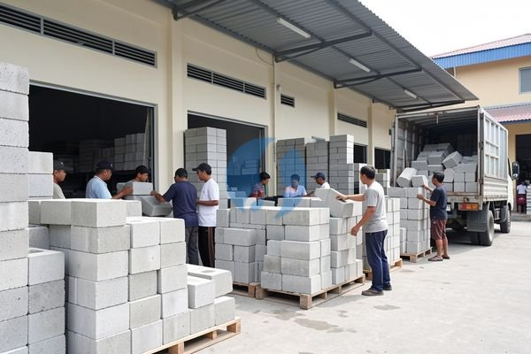

**Toko Batako Terdekat untuk Renovasi dan Bangunan Baru** - Mitra Sumber Material, siap membantu Anda menemukan solusi material bangunan yang tepat untuk proyek Anda. Mencari batako berkualitas untuk konstruksi rumah, pagar, atau bangunan lainnya? Kami punya solusinya!



Memilih batako yang tepat memang penting, lho. Ada banyak pertimbangan, mulai dari ukuran, kekuatan, hingga harga. Nah, daripada bingung sendiri, yuk kita bahas lebih lanjut agar Mitra Sumber Material bisa mendapatkan batako yang paling sesuai kebutuhan proyek. Kami siap memberikan konsultasi gratis sebelum Anda membuat keputusan.

## Mencari Batako Berkualitas: Apa yang Perlu Diperhatikan?

Ketika mencari toko batako terdekat, kualitas adalah hal utama yang harus diperhatikan. Batako yang bagus akan memberikan kekuatan dan ketahanan pada bangunan Anda. Pertimbangkan beberapa hal berikut:

- **Jenis Batako:** Ada batako biasa, batako hollow (berongga), dan batako ringan. Batako hollow sering dipilih karena lebih ringan dan hemat material, namun kekuatan tekan bisa berbeda antar merek.
- **Ukuran:** Ukuran batako standar biasanya 40x20x10 cm, tapi ada juga variasi lain. Pastikan ukuran batako sesuai dengan desain bangunan Anda.
- **Kekuatan Tekan:** Ini penting untuk memastikan batako mampu menahan beban bangunan. Semakin tinggi kekuatan tekannya, semakin kuat batako tersebut.
- **Harga:** Harga batako bervariasi tergantung jenis, ukuran, dan kualitas. Jangan terpaku pada harga murah, tapi perhatikan juga kualitasnya.

Nah, untuk memastikan Anda tidak salah pilih, jangan ragu untuk bertanya kepada Kami. Kami akan membantu Anda menentukan jenis batako yang paling sesuai dengan anggaran dan kebutuhan proyek Anda. Tanyakan harga terbaru dan ketersediaan stok lewat tombol **WhatsApp** di bawah ini.

## Batako Berkualitas dari Sumber Material: Pilihan Lengkap untuk Proyek Anda

Sumber Material menyediakan berbagai jenis batako dengan kualitas terjamin. Kami memiliki batako hollow dengan berbagai ukuran dan kekuatan tekan. Beberapa contoh yang tersedia:

- **Batako Hollow Standar:** Ukuran 40x20x10 cm, cocok untuk dinding dan pagar.
- **Batako Hollow Ringan:** Ukuran 40x20x10 cm, lebih ringan sehingga memudahkan proses pemasangan.
- **Batako Custom:** Kami juga menerima pesanan batako dengan ukuran dan bentuk sesuai permintaan Mitra Sumber Material.

Selain batako, Kami juga menyediakan material bangunan lainnya seperti pasir, batu, semen, besi, dan baja ringan. Jadi, Anda bisa mendapatkan semua kebutuhan bangunan Anda dalam satu tempat. Kami juga menyediakan jasa urug dan jasa cor untuk proyek Mitra Sumber Material.

## Kenapa Harus Memesan Batako di Sumber Material?

Ada banyak alasan mengapa Anda harus memilih Sumber Material sebagai toko batako terdekat Anda. Pertama, Kami memberikan pelayanan konsultasi gratis. Anda bisa bertanya tentang spesifikasi batako, perkiraan kebutuhan material, dan cara pemasangan. Ini penting banget, lho, supaya tidak ada salah beli atau kekurangan material.

Kedua, Kami melayani pengiriman ke seluruh wilayah Jabodetabek dan sekitarnya. Jadi, Anda tidak perlu repot-repot mengambil material sendiri. Ketiga, Kami menawarkan harga yang kompetitif. Kami selalu berusaha memberikan harga terbaik untuk mitra setia Kami. Keempat, Kami berlokasi strategis di Bogor, Jakarta, Bekasi, Karawang, Tangerang, dan Cikarang, sehingga memudahkan akses bagi Anda.

Selain itu, Kami juga jujur dalam memberikan informasi. Kami tidak akan menjanjikan diskon besar atau stok tak terbatas jika memang tidak ada. Kami lebih memilih untuk memberikan informasi yang akurat dan transparan. Jangan tunda kebutuhan proyek Anda — tanyakan harga dan ketersediaan batako sekarang juga lewat tombol **Telepon** di bawah.

## Pesan Batako Mudah dan Cepat

Memesan batako di Sumber Material sangat mudah. Anda bisa menghubungi Kami melalui tombol **WhatsApp** atau **Telepon** yang tersedia di halaman ini. Sampaikan kebutuhan Anda, termasuk jenis batako, ukuran, dan jumlah yang dibutuhkan. Tim Kami akan segera merespons dan memberikan penawaran terbaik. Prosesnya cepat dan tanpa ribet. Kami juga siap membantu menghitung kebutuhan batako untuk proyek Anda, jadi Anda tidak perlu khawatir kehabisan material.

Jangan tunda kebutuhan proyek Mitra Sumber Material — tanyakan harga dan ketersediaannya sekarang lewat tombol **WhatsApp** atau **Telepon** di bawah halaman ini.

ARTIKEL_SELESAI

## Hitung Kebutuhan Batako: Jangan Sampai Kurang atau Kelebihan!

Seringkali Mitra Sumber Material bertanya, “Batako berapa yang saya butuhkan untuk proyek saya?” Pertanyaan bagus! Menghitung kebutuhan batako dengan tepat itu penting banget, lho. Kurang, nanti proyek jadi terhambat. Kelebihan, malah buang-buang anggaran. Nah, yuk kita lihat contoh perhitungannya.

Misalnya, Anda ingin membangun dinding dengan panjang 10 meter dan tinggi 3 meter. Lebar dindingnya 15 cm (setara dengan ketebalan setengah batako). Kita pakai batako standar ukuran 40x20x10 cm. Pertama, hitung luas dinding: 10 m x 3 m = 30 m². Lalu, hitung luas satu batako dalam meter persegi: 0,4 m x 0,2 m = 0,08 m².  Terakhir, bagi luas dinding dengan luas satu batako: 30 m² / 0,08 m² = 375 buah. Jadi, Anda membutuhkan sekitar 375 buah batako.

## Batako Hollow vs. Batako Padat: Mana yang Lebih Cocok untuk Anda?

Mitra Sumber Material pasti bertanya-tanya, batako hollow atau batako padat, mana yang lebih baik? Keduanya punya kelebihan dan kekurangan masing-masing. Batako hollow, seperti yang Kami sediakan, lebih ringan dan hemat material. Ini menghemat biaya konstruksi dan mempercepat proses pemasangan. Karena berongga, batako hollow juga lebih baik dalam isolasi termal dan akustik. Artinya, rumah Anda akan lebih sejuk dan kedap suara.

Namun, kekuatan tekan batako hollow biasanya lebih rendah daripada batako padat. Jadi, untuk bangunan bertingkat atau yang membutuhkan kekuatan ekstra, batako padat mungkin lebih cocok. Tapi, perlu diingat, batako padat lebih berat dan membutuhkan biaya transportasi yang lebih tinggi.

Nah, untuk proyek rumah tinggal atau pagar biasa, batako hollow dari Sumber Material sudah sangat memadai. Kami menyediakan berbagai pilihan kekuatan tekan, jadi Anda bisa memilih yang sesuai dengan kebutuhan proyek Anda. Jangan ragu untuk konsultasi dengan Kami untuk mendapatkan rekomendasi terbaik.

## Pertanyaan Seputar Batako: FAQ dari Mitra Sumber Material

Banyak pertanyaan menarik yang sering Kami terima dari Mitra Sumber Material. Berikut beberapa di antaranya:

### Berapa Daya Tahan Batako Terhadap Cuaca?

Batako cukup tahan terhadap cuaca, terutama jika dilapisi dengan plester atau cat. Namun, batako yang terus-menerus terpapar air hujan atau kelembapan tinggi bisa mengalami kerusakan. Jadi, pastikan dinding batako dilapisi dengan pelindung yang tepat.

### Apakah Batako Mudah Retak atau Pecah?

Batako bisa retak atau pecah jika terkena benturan keras. Jadi, saat pengiriman dan pemasangan, hati-hati jangan sampai batako terjatuh atau terbentur. Kami selalu memastikan batako Kami dikemas dengan aman untuk mencegah kerusakan selama pengiriman.

### Bagaimana Cara Merawat Dinding Batako?

Perawatan dinding batako cukup sederhana. Cukup bersihkan secara berkala dengan air dan sabun. Hindari menggunakan bahan kimia keras yang bisa merusak permukaan batako. Jika ada retakan, segera perbaiki agar tidak semakin besar.

### Bisakah Batako Dipakai untuk Membuat Septic Tank?

Bisa, tapi tidak disarankan. Batako kurang kedap air, sehingga septic tank yang terbuat dari batako bisa bocor dan mencemari lingkungan. Sebaiknya gunakan material yang lebih kedap air, seperti beton bertulang, untuk membuat septic tank.

## Kesalahan Umum Saat Membeli Batako: Hindari Masalah di Proyek Anda

Banyak Mitra Sumber Material yang pernah mengalami masalah karena kesalahan saat membeli batako. Salah satunya adalah tidak memperhatikan variasi ukuran. Batako dari produsen berbeda bisa sedikit berbeda ukurannya, meski sama-sama disebut batako standar. Perbedaan ini mungkin tidak terlihat signifikan, tapi bisa menyebabkan masalah saat pemasangan, terutama jika Anda mencampur batako dari beberapa sumber.

Kesalahan lain yang sering terjadi adalah tidak menghitung kebutuhan dengan cermat. Akibatnya, Anda bisa kekurangan batako di tengah proyek, yang akan menunda penyelesaiannya. Atau, justru kelebihan batako, yang berarti pemborosan anggaran.

## Lebih Dekat dengan Batako: Ukuran dan Berat yang Perlu Anda Ketahui

Sebagai informasi tambahan, batako standar biasanya memiliki berat sekitar 12-15 kg per buah. Berat ini bisa bervariasi tergantung pada kepadatan material dan proses pembuatannya. Memahami ukuran dan berat batako akan membantu Anda dalam perencanaan pengangkutan dan pemasangan. Misalnya, jika Anda menggunakan jasa angkut, penting untuk mengetahui berat total batako yang akan diangkut agar tidak melebihi kapasitas kendaraan.

## Tanya Jawab Seputar Batako: Apa yang Sering Ditanyakan Pelanggan Kami?

### Apakah batako perlu direndam sebelum dipasang?

Sebaiknya direndam sebentar (sekitar 15-30 menit) untuk mengurangi penyerapan air dari adukan semen. Ini akan membuat batako lebih kuat merekat.

### Bagaimana cara memotong batako jika ukurannya tidak pas?

Gunakan mesin potong keramik atau gergaji beton dengan mata pisau yang sesuai. Pastikan Anda menggunakan alat pelindung diri seperti kacamata dan masker.

### Apakah batako bisa digunakan untuk membuat fondasi?

Tidak disarankan. Batako kurang kuat untuk menahan beban fondasi. Sebaiknya gunakan beton bertulang untuk fondasi bangunan Anda.

### Bagaimana cara mengatasi batako yang retak saat pengiriman?

Laporkan segera ke Kami. Kami akan mengganti batako yang rusak dengan yang baru.

Semoga jawaban ini membantu, ya! Kalau ada pertanyaan lain, jangan ragu untuk menghubungi Kami. Kami selalu siap membantu Mitra Sumber Material.
