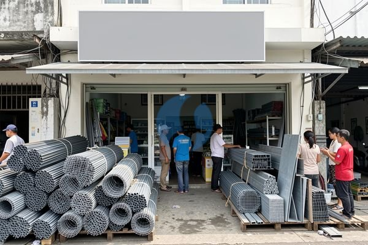

**Toko Besi Terdekat untuk Renovasi dan Bangunan Baru** - Mitra Sumber Material yang berbahagia, apakah Anda sedang mencari toko besi terdekat untuk melengkapi kebutuhan proyek konstruksi Anda? Kami siap melayani!



Mencari material besi yang berkualitas dengan harga bersaing memang membutuhkan riset. Nah, daripada buang waktu keliling toko material, yuk langsung hubungi Kami. Kami siap membantu mencarikan besi yang tepat, menghitung kebutuhan, dan mengirimkannya langsung ke lokasi proyek Anda di Jabodetabek dan sekitarnya.

## Pilihan Besi yang Tepat untuk Proyek Anda: Apa yang Perlu Dipertimbangkan?

Sebelum memutuskan membeli besi, pastikan Anda sudah mempertimbangkan beberapa hal penting. Jenis besi yang dibutuhkan sangat bergantung pada jenis proyek yang dikerjakan. Apakah untuk struktur bangunan, tulangan beton, atau kebutuhan konstruksi lainnya? Memilih besi yang tidak sesuai standar bisa berakibat fatal. Mitra, penting untuk memastikan besi yang Anda beli memiliki sertifikasi SNI agar kualitasnya terjamin. Selain itu, pertimbangkan juga ukuran dan diameter besi yang sesuai dengan rencana anggaran biaya (RAB) proyek Anda.

Jika Anda masih bingung, jangan ragu untuk konsultasi dengan tim Kami. Kami siap memberikan rekomendasi material yang paling sesuai dengan kebutuhan dan anggaran Anda. Jangan tunda, segera [tanyakan harga terbaru](https://api.whatsapp.com/send?phone=6285776786091&text=*Halo%20sumbermaterial.com*%20%3A) untuk mendapatkan penawaran menarik!

## Material Besi Berkualitas dari Sumber Material

Kami di Sumber Material menyediakan berbagai macam material besi untuk memenuhi kebutuhan konstruksi Anda. Beberapa produk unggulan Kami antara lain:

- **Besi Beton:** Tersedia dalam berbagai ukuran diameter (8mm, 10mm, 12mm, 16mm, dan seterusnya) dan panjang standar (8 meter atau 12 meter). Cocok untuk tulangan utama pada struktur beton.
- **Wiremesh:** Tersedia dalam berbagai ukuran mata dan diameter kawat. Sangat ideal untuk lantai beton, dinding, atau penutup lantai.
- **Baja Ringan:** Alternatif yang lebih ringan dan cepat untuk konstruksi rangka atap. Tersedia dalam berbagai profil seperti C-Channel dan R-Channel.
- **Besi Hollow:** Pilihan yang tepat untuk berbagai kebutuhan konstruksi ringan, seperti rangka pintu dan jendela, pagar, atau kanopi.
- **Besi Siku:** Digunakan sebagai penguat sambungan atau rangka konstruksi. Tersedia dalam berbagai ukuran dan ketebalan.

Contohnya, untuk proyek rumah 2 lantai, Anda akan membutuhkan besi beton dengan diameter minimal 12mm untuk kolom dan balok, serta wiremesh dengan mata 150mm untuk lantai. Kami siap membantu menghitung kebutuhan material besi secara akurat, sehingga Anda tidak perlu khawatir kelebihan atau kekurangan material.

## Kenapa Memilih Toko Besi Terdekat? Keuntungan Memesan dari Sumber Material

Mengapa Anda harus memilih Kami sebagai toko besi terdekat Anda? Ada beberapa alasan yang bisa Kami berikan:

1.  **Kemudahan Pemesanan:** Cukup kirim kebutuhan dan lokasi proyek Anda lewat WhatsApp, dan kami akan bantu menghitung kebutuhan material serta memberikan penawaran harga terbaik.
2.  **Kualitas Terjamin:** Kami hanya menyediakan material besi berkualitas tinggi yang telah memenuhi standar SNI.
3.  **Harga Bersaing:** Kami menawarkan harga yang kompetitif dengan kualitas yang tidak perlu diragukan lagi.
4.  **Pengiriman Cepat:** Kami melayani pengiriman ke seluruh wilayah Jabodetabek dan sekitarnya.
5.  **Pelayanan Profesional:** Tim Kami siap membantu memberikan konsultasi dan solusi terbaik untuk kebutuhan proyek Anda.
6.  **Lokasi Strategis:** Berlokasi di Bogor, Jakarta, Bekasi, Karawang, Tangerang, dan Cikarang, Kami memastikan ketersediaan stok dan pengiriman yang cepat.

Mitra Sumber Material, jangan terkendala lokasi! Kami hadir untuk memudahkan Anda mendapatkan material besi berkualitas tanpa harus repot mencari toko besi terdekat.

## Pesan Besi Impian Anda Sekarang!

Memastikan ketersediaan material besi yang tepat dan berkualitas adalah kunci keberhasilan proyek Anda. Jangan biarkan kekurangan material menunda penyelesaian proyek Anda. Kami siap membantu menghitung kebutuhan material besi secara akurat dan menyediakan pengiriman tepat waktu ke lokasi proyek Anda.

## Menghitung Kebutuhan Besi Beton: Contoh Praktis untuk Proyek Rumah

Seringkali Mitra Sumber Material merasa kesulitan menghitung kebutuhan besi beton yang tepat untuk proyek konstruksi. Jangan khawatir, Kami akan berikan contoh perhitungan sederhana untuk membantu Anda. Misalkan Anda akan membuat pondasi rumah dengan ukuran 6 meter x 8 meter dan tinggi 40 cm.

Pertama, hitung volume pondasi: 6 m x 8 m x 0,4 m = 19,2 m³. Kemudian, tentukan kebutuhan besi beton per meter kubik. Untuk pondasi rumah biasa, biasanya digunakan sekitar 80-100 kg besi beton per m³. Mari kita ambil angka tengah, yaitu 90 kg/m³. Jadi, total besi beton yang dibutuhkan adalah 19,2 m³ x 90 kg/m³ = 1728 kg.

## Memilih Besi Beton: Perbandingan Mutu dan Aplikasi

Mitra, ada beberapa mutu besi beton yang umum digunakan di pasaran, yaitu BJTP (Besi Beton Tulangan Polos) dan BJJTP (Besi Beton Tulangan Polos). Perbedaan utama terletak pada kekuatan tarik dan kekuatan lelehnya. BJTP memiliki kekuatan leleh minimal 400 MPa, sedangkan BJJTP memiliki kekuatan leleh minimal 500 MPa.

Berikut perbandingan singkatnya:

| Mutu Besi Beton | Kekuatan Leleh (MPa) | Aplikasi Umum                               |
|-------------------|----------------------|---------------------------------------------|
| BJTP              | 400                  | Fondasi rumah, sloof, kolom kecil           |
| BJJTP             | 500                  | Kolom besar, balok, struktur bertingkat tinggi |

Pemilihan mutu besi beton harus disesuaikan dengan kebutuhan dan rekomendasi dari ahli struktur. Untuk bangunan rumah biasa, BJTP biasanya sudah mencukupi. Namun, untuk bangunan yang lebih kompleks atau tinggi, sebaiknya gunakan BJJTP untuk memastikan kekuatan dan keamanan struktur.

### Pertanyaan Umum Seputar Besi dan Material Konstruksi

Banyak pertanyaan yang sering Kami terima dari Mitra Sumber Material. Berikut beberapa di antaranya:

**### Apa perbedaan wiremesh dan besi beton?**

Wiremesh adalah jaring kawat baja yang digunakan untuk memperkuat beton. Sementara besi beton adalah batang baja yang diletakkan di dalam beton untuk menahan gaya tarik. Wiremesh lebih cocok untuk area luas dengan beban ringan, sedangkan besi beton lebih cocok untuk area yang menahan beban berat.

**### Bagaimana cara mengetahui kualitas besi beton?**

Periksa sertifikasi SNI pada besi beton. Perhatikan juga permukaan besi beton, apakah terdapat karat atau cacat lainnya. Besi beton yang berkualitas memiliki permukaan yang bersih dan rata.

**### Apakah besi beton bisa berkarat?**

Ya, besi beton bisa berkarat jika terkena air dan udara. Karat dapat mengurangi kekuatan besi beton. Oleh karena itu, penting untuk memberikan lapisan pelindung pada besi beton, seperti beton itu sendiri.

**### Berapa jarak ideal pemasangan besi beton?**

Jarak pemasangan besi beton bervariasi tergantung pada jenis struktur dan beban yang diterima. Konsultasikan dengan ahli struktur untuk mendapatkan rekomendasi yang tepat.

## Hindari Kesalahan Umum Saat Membeli Besi Beton

Mitra Sumber Material, seringkali Kami temui pembeli yang melakukan kesalahan saat memilih dan memesan besi beton. Salah satu yang paling umum adalah tidak memperhatikan ukuran dan diameter besi yang dibutuhkan. Akibatnya, besi yang dibeli tidak sesuai dengan spesifikasi proyek dan harus dibeli ulang, membuang waktu dan biaya. Kesalahan lainnya adalah membeli besi beton tanpa memastikan adanya sertifikasi SNI. Besi beton tanpa SNI berpotensi memiliki kualitas yang rendah dan tidak memenuhi standar keamanan. Penting juga untuk memeriksa kondisi besi beton sebelum dibeli, pastikan tidak ada karat atau cacat yang dapat mengurangi kekuatannya.

## Tanya Jawab Seputar Pembelian Besi

Berikut beberapa pertanyaan yang sering Kami terima dari Mitra Sumber Material:

### Berapa lama besi beton bisa disimpan sebelum digunakan?

Besi beton sebaiknya digunakan segera setelah dibeli. Jika harus disimpan, simpan di tempat yang kering dan terlindungi dari karat. Jangan menumpuk besi beton terlalu tinggi agar tidak terjadi kerusakan.

### Apakah besi beton bisa dipotong sendiri?

Besi beton bisa dipotong sendiri menggunakan mesin potong besi. Namun, pastikan Anda menggunakan alat yang sesuai dan mengikuti prosedur keselamatan yang benar. Jika tidak yakin, sebaiknya serahkan pemotongan besi beton kepada ahlinya.

### Bagaimana cara mengetahui berat besi beton per meter?

Berat besi beton per meter bervariasi tergantung pada diameternya. Anda bisa mencari informasi berat besi beton per meter secara online atau berkonsultasi dengan Kami.

### Apa yang dimaksud dengan "tulang baja" pada besi beton?

"Tulang baja" adalah istilah lain untuk besi beton. Istilah ini sering digunakan untuk merujuk pada besi beton yang digunakan sebagai tulangan dalam konstruksi beton.

Jangan tunda kebutuhan proyek Mitra Sumber Material — tanyakan harga dan ketersediaannya sekarang lewat tombol **WhatsApp** atau **Telepon** di bawah halaman ini.
