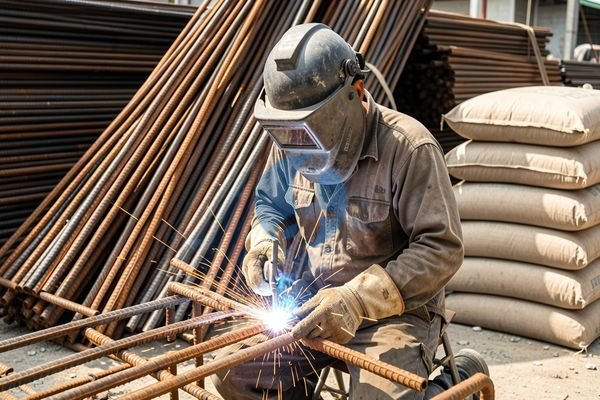

**Daftar Periksa sebelum Memakai Tukang Besi Terdekat** - Mitra Sumber Material dimana saja berada, mencari tukang besi terdekat untuk proyek konstruksi bisa jadi tantangan. Kami siap menyediakan material besi berkualitas dengan pengiriman cepat ke lokasi Anda.



Punya rencana membangun atau merenovasi? Memilih material besi yang tepat adalah kunci utama keberhasilan proyek. Nah, daripada sibuk mencari tukang besi terdekat yang terkadang kualitasnya diragukan, lebih baik fokus pada penyedia material terpercaya seperti Kami. Mitra Sumber Material hadir untuk memastikan proyek Anda berjalan lancar dengan material besi terbaik dan layanan konsultasi profesional.

## Butuh Besi Cepat? Jangan Sampai Salah Pilih!

Saat mencari “tukang besi terdekat”, Mitra mungkin akan menemukan banyak pilihan. Tapi, apakah semua penyedia bisa menjamin kualitas dan ketersediaan barang? Banyak yang menawarkan harga murah, namun seringkali kualitasnya tidak sesuai standar. Ini justru akan merugikan Anda di kemudian hari karena material cepat rusak dan perlu penggantian.

Nah, di Sumber Material, Kami tidak hanya menyediakan material besi, tapi juga memberikan kepastian kualitas. Kami hanya bekerja sama dengan produsen terpercaya yang sudah teruji kualitasnya. Selain itu, Kami juga menyediakan layanan konsultasi gratis untuk membantu Anda memilih jenis besi yang paling sesuai dengan kebutuhan proyek Anda. Yuk, konsultasikan kebutuhan proyek Anda sekarang juga!

## Material Besi Lengkap untuk Segala Kebutuhan Proyek Anda

Kami menyediakan berbagai jenis material besi yang Anda butuhkan, mulai dari besi beton, wiremesh, hingga baja ringan. Berikut beberapa produk unggulan Kami:

- **Besi Beton:** Tersedia dalam berbagai ukuran dan mutu (misalnya, besi beton diameter 10mm, 12mm, 16mm dengan mutu BJTP 400). Cocok untuk fondasi, kolom, dan balok bangunan.
- **Wiremesh:** Tersedia dalam berbagai ukuran mata dan ketebalan. Ideal untuk memperkuat lantai beton dan mencegah retak rambut.
- **Baja Ringan:** Solusi praktis untuk konstruksi rangka atap yang ringan, kuat, dan tahan karat. Tersedia berbagai profil seperti C75, C100, dan kanal.
- **Besi Hollow:** Beragam ukuran dan ketebalan, cocok untuk konstruksi rangka bangunan, pagar, atau railing.

## Mengapa Memesan Besi di Sumber Material?

Memilih Sumber Material sebagai pemasok material besi Anda memberikan banyak keuntungan. Pertama, Kami bantu Anda menghemat waktu dengan menyediakan material lengkap dalam satu tempat. Tidak perlu lagi repot mencari ke berbagai toko material yang berbeda. Kedua, Kami memberikan layanan konsultasi gratis. Tim ahli Kami siap membantu Anda menghitung kebutuhan besi secara akurat, sehingga Anda tidak perlu khawatir kelebihan atau kekurangan material.

Selain itu, Kami melayani pengiriman ke seluruh wilayah Jabodetabek dan sekitarnya. Pesanan Anda akan diantar langsung ke lokasi proyek, sehingga Anda tidak perlu repot mengangkutnya sendiri. Terakhir, Kami berkomitmen untuk memberikan harga yang kompetitif dan pelayanan yang terbaik. Kami berlokasi di Bogor, Jakarta, Bekasi, Karawang, Tangerang, dan Cikarang, memudahkan akses dan pengiriman pesanan Anda.

## Mudah dan Cepat: Begini Cara Pesan Material Besi di Sumber Material

Memesan material besi di Sumber Material sangat mudah. Anda bisa langsung menghubungi Kami melalui tombol **WhatsApp** atau **Telepon** yang ada di bawah halaman ini. Sampaikan kebutuhan proyek Anda secara detail, termasuk jenis besi, ukuran, dan jumlah yang dibutuhkan. Tim Kami akan segera memberikan penawaran harga terbaik.

Atau, Anda bisa mengirimkan daftar material dan lokasi proyek Anda lewat WhatsApp. Kami akan segera memproses pesanan Anda dan mengatur pengiriman secepatnya. Jangan ragu untuk bertanya jika Anda memiliki pertanyaan lebih lanjut. Kami siap membantu Anda mewujudkan proyek impian Anda!

Jangan tunda kebutuhan proyek Mitra Sumber Material — tanyakan harga dan ketersediaannya sekarang lewat tombol **WhatsApp** atau **Telepon** di bawah halaman ini.

ARTIKEL_SELESAI

## Perhitungan Kebutuhan Besi Beton: Jangan Sampai Boros!

Mitra Sumber Material seringkali menghadapi kesulitan dalam menghitung kebutuhan besi beton untuk proyek mereka. Salah perhitungan bisa berakibat fatal, baik dari segi biaya maupun kekuatan struktur. Nah, Kami akan berikan contoh perhitungan sederhana untuk membantu Anda meminimalkan risiko kesalahan.

Misalnya, Anda akan membuat kolom dengan dimensi 30cm x 30cm dan panjang 4 meter. Untuk tulangan utama, kita asumsikan menggunakan besi diameter 16mm dengan jarak antar tulangan 30cm. Pertama, hitung luas penampang tulangan utama: π * (8mm)^2 = 201.06 mm². Kemudian, hitung jumlah tulangan yang dibutuhkan dalam satu bidang: 30cm / 30cm = 1 tulangan per bidang. Karena kolom persegi, dibutuhkan 4 tulangan utama. Jadi, total luas penampang tulangan utama adalah 201.06 mm² * 4 = 804.24 mm².

Selanjutnya, hitung kebutuhan besi untuk sengkang (beugel). Misalkan menggunakan besi diameter 10mm dengan jarak 20cm. Luas penampang satu sengkang adalah π * (5mm)^2 = 78.54 mm². Tinggi sengkang diasumsikan 20cm. Jarak antar sengkang adalah 20cm, sehingga dibutuhkan 4 / 0.2 = 20 sengkang per meter panjang kolom. Untuk kolom sepanjang 4 meter, dibutuhkan 20 sengkang/meter * 4 meter = 80 sengkang.

Jadi, total kebutuhan besi beton untuk kolom ini adalah: besi utama (804.24 mm²) dan sengkang (80 buah). Jangan lupa, ini hanya contoh sederhana. Untuk perhitungan yang lebih akurat, sebaiknya konsultasikan dengan ahli struktur atau langsung tanyakan ke Kami. Kami bantu hitungkan kebutuhan besi untuk proyek Anda secara detail dan presisi.

## Memilih Besi Beton yang Tepat: BJTP 400 vs BJTP 500

Mitra Sumber Material mungkin sering mendengar istilah BJTP 400 dan BJTP 500 saat memilih besi beton. Apa sebenarnya perbedaan keduanya? BJTP (Besi Beton Tulangan Polos) menunjukkan kekuatan tarik minimum besi beton. BJTP 400 memiliki kekuatan tarik minimum 400 MPa (MegaPascal), sedangkan BJTP 500 memiliki kekuatan tarik minimum 500 MPa.

Secara umum, BJTP 500 lebih kuat dan lebih efisien daripada BJTP 400. Artinya, dengan BJTP 500, Anda bisa menggunakan diameter besi yang lebih kecil untuk menahan beban yang sama, sehingga menghemat material. Namun, BJTP 500 juga lebih mahal daripada BJTP 400.

Kapan sebaiknya menggunakan BJTP 500? Biasanya, BJTP 500 direkomendasikan untuk struktur beton bertulang yang membutuhkan kekuatan tinggi, seperti bangunan bertingkat tinggi atau jembatan. Untuk bangunan rumah tinggal sederhana, BJTP 400 biasanya sudah cukup memadai. Konsultasikan dengan Kami untuk menentukan jenis besi beton yang paling sesuai dengan kebutuhan proyek Anda.

## Pertanyaan Umum Seputar Pemesanan Besi di Sumber Material

Berikut beberapa pertanyaan yang sering Kami terima dari Mitra Sumber Material:

### Berapa lama waktu pengiriman?

Waktu pengiriman bervariasi tergantung jarak dan ketersediaan barang. Untuk wilayah Jabodetabek, biasanya Kami bisa mengirimkan pesanan dalam 1-3 hari kerja.

### Apakah bisa pesan dalam jumlah sedikit?

Tentu saja! Kami melayani pemesanan dalam jumlah kecil maupun besar. Tidak ada minimum order.

### Bagaimana jika ada besi yang cacat atau kurang?

Kami menjamin kualitas produk Kami. Jika ada besi yang cacat atau kurang, segera hubungi Kami dan Kami akan segera menggantinya.

### Apakah ada biaya tambahan untuk pengiriman?

Biaya pengiriman akan Kami informasikan sebelum pesanan Anda diproses. Biaya tersebut tergantung jarak dan volume pesanan. Nah, jangan sungkan untuk bertanya detailnya ke Kami ya.

## Tanya Jawab Seputar Pemesanan Besi

### Apakah Kami bisa membantu memotong besi sesuai ukuran?

Bisa, Mitra! Kami menyediakan layanan potong besi sesuai ukuran yang Anda butuhkan. Ini akan menghemat waktu dan tenaga Anda di lokasi proyek.

### Bagaimana jika saya tidak yakin jenis besi apa yang dibutuhkan?

Jangan khawatir! Tim ahli Kami siap membantu Anda berkonsultasi dan memberikan rekomendasi terbaik berdasarkan kebutuhan proyek Anda.

### Apakah ada minimal pembelian untuk pengiriman ke lokasi proyek?

Tidak ada, Mitra. Kami melayani pengiriman dalam jumlah berapapun, bahkan untuk kebutuhan proyek kecil sekalipun.

### Bagaimana cara memastikan besi yang diterima tidak berkarat?

Kami memastikan besi beton Kami disimpan dengan baik dan terlindungi dari cuaca. Saat pengiriman, besi akan Kami bungkus dengan rapi untuk meminimalkan risiko karat.
