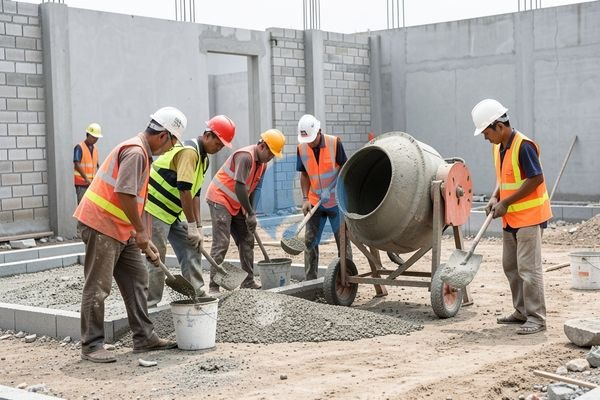

**Kesalahan yang Sering Terjadi pada Tukang Cor Bangunan** - Mitra, ## Mencari Tukang Cor Bangunan yang Tepat: Apa yang Perlu Diperhatikan?



Memilih tukang cor bangunan bukan perkara sepele. Banyak faktor yang perlu dipertimbangkan, mulai dari pengalaman, reputasi, hingga pemahaman tentang standar kualitas. Banyak pemilik proyek yang akhirnya harus berurusan dengan tukang yang kurang berpengalaman, yang berujung pada hasil cor yang kurang memuaskan dan biaya perbaikan yang membengkak. Nah, sebelum memutuskan siapa yang akan Anda percaya, ada beberapa hal penting yang perlu menjadi perhatian. Pertama, pastikan tukang cor tersebut memiliki pengalaman yang relevan dengan jenis proyek Anda. Apakah itu cor lantai, kolom, balok, atau fondasi, pengalaman spesifik akan sangat berpengaruh pada kualitas hasil pekerjaan. Kedua, perhatikan reputasi mereka. Anda bisa mencari referensi dari teman, keluarga, atau kontraktor lain yang pernah menggunakan jasa mereka. Ketiga, pastikan tukang cor tersebut memahami pentingnya penggunaan material yang berkualitas. Kami di Sumber Material siap membantu Anda menyediakan material cor terbaik, mulai dari pasir, semen, hingga besi beton, yang sesuai dengan standar SNI. Untuk kemudahan pengadaan material, Anda bisa [tanyakan harga pasir cor](https://api.whatsapp.com/send?phone=6285776786091&text=*Halo%20sumbermaterial.com*%20%3A).

## Material Cor Bangunan yang Berkualitas: Kunci Kekuatan dan Keawetan

Kualitas hasil cor bangunan sangat bergantung pada kualitas material yang digunakan. Jangan sampai Anda menghemat di awal, tapi malah harus mengeluarkan biaya lebih besar di kemudian hari untuk perbaikan. Beberapa material penting yang perlu diperhatikan antara lain:

- **Semen:** Pilih semen yang memiliki mutu yang sesuai dengan kebutuhan proyek Anda. Semen Portland (OPC) adalah pilihan umum, tetapi ada juga semen khusus untuk aplikasi tertentu, seperti semen tahan sulfat untuk area dengan kandungan sulfur tinggi.
- **Pasir:** Gunakan pasir yang bersih dan bebas dari kotoran organik. Pasir yang ideal untuk cor adalah pasir beton atau pasir cor dengan ukuran butir yang sesuai. Kami menyediakan [pasir cor cimalaka](/blog/pasir-cor-cimalaka/) yang sudah teruji kualitasnya.
- **Besi Beton:** Pastikan besi beton yang digunakan memiliki kekuatan tarik yang sesuai dengan perhitungan struktur. Pilih besi beton dengan diameter yang tepat dan pastikan tidak ada karat atau cacat lainnya.
- **Air:** Gunakan air bersih yang bebas dari minyak, garam, atau zat kimia lainnya yang dapat mempengaruhi proses pengerasan beton.

Selain material utama di atas, Anda juga perlu memperhatikan penggunaan *admixture* (bahan tambahan) yang tepat. *Admixture* dapat membantu meningkatkan sifat-sifat beton, seperti kekuatan, ketahanan terhadap air, dan kemudahan pengerjaan.

## Mengapa Memilih Sumber Material untuk Kebutuhan Cor Bangunan Anda?

Kami di Sumber Material menawarkan solusi lengkap untuk kebutuhan cor bangunan Anda. Tidak hanya menyediakan material berkualitas tinggi, kami juga menyediakan jasa tukang cor bangunan profesional yang berpengalaman dan terpercaya. Dengan memesan melalui Kami, Mitra akan mendapatkan banyak keuntungan:

- **Hemat Waktu dan Tenaga:** Kami menyediakan *one-stop solution* untuk kebutuhan proyek Anda. Anda tidak perlu lagi repot mencari dan mengkoordinasikan berbagai supplier dan tenaga kerja.
- **Kualitas Terjamin:** Kami hanya menyediakan material yang sudah teruji kualitasnya dan sesuai dengan standar SNI. Tukang cor bangunan yang Kami sediakan juga memiliki pengalaman dan keahlian yang mumpuni.
- **Harga Kompetitif:** Kami menawarkan harga yang kompetitif dan transparan. Anda bisa kirim kebutuhan dan lokasi proyek Anda untuk mendapatkan penawaran terbaik.
- **Jangkauan Luas:** Kami melayani pengiriman material dan jasa ke seluruh wilayah Jabodetabek dan sekitarnya. Kami berlokasi di Bogor, Jakarta, Bekasi, Karawang, Tangerang, dan Cikarang, sehingga pengiriman bisa lebih cepat dan efisien.
- **Solusi Terintegrasi:** Kami tidak hanya menyediakan material dan tukang cor, tetapi juga menyediakan sewa alat berat serta jasa urug dan jasa cor. Ini akan sangat memudahkan Mitra dalam menyelesaikan proyek dengan lebih cepat dan efisien.

## Pesan Tukang Cor dan Material Bangunan dengan Mudah

Pesan tukang cor bangunan dan material bangunan berkualitas dari Sumber Material sangat mudah. Anda bisa menghubungi Kami melalui tombol **WhatsApp** atau **Telepon** di bawah. Sampaikan kebutuhan proyek Anda secara detail, termasuk lokasi proyek, jenis pekerjaan, dan volume material yang dibutuhkan. Tim Kami akan dengan senang hati membantu menghitung kebutuhan material, memberikan penawaran harga terbaik, dan mengatur jadwal pengerjaan. Jangan tunda lagi, segera hubungi Kami untuk mendapatkan hasil cor bangunan yang kuat, tahan lama, dan sesuai dengan harapan Anda.

Mau tahu harga terbaru untuk kebutuhan proyek Mitra Sumber Material? Klik tombol **WhatsApp** atau **Telepon** di bawah, kirim kebutuhan dan lokasi proyek, Kami bantu hitungkan.

ARTIKEL_SELESAI

## Perhitungan Kebutuhan Material Cor: Contoh Kasus untuk Proyek Rumah

Seringkali, Mitra Sumber Material mengalami kesulitan dalam menghitung kebutuhan material cor yang tepat. Akibatnya, bisa terjadi kekurangan material di tengah pekerjaan, atau justru kelebihan yang mubazir. Nah, mari kita ambil contoh kasus sederhana: Anda akan membuat fondasi rumah dengan ukuran panjang 8 meter, lebar 1 meter, dan tinggi 0,4 meter. Asumsikan rasio campuran beton yang umum digunakan adalah 1:2:3 (semen:pasir:kerikil).

Untuk menghitung volume beton yang dibutuhkan, kita gunakan rumus: Volume = Panjang x Lebar x Tinggi = 8 m x 1 m x 0,4 m = 3,2 m³.

Selanjutnya, kita hitung kebutuhan masing-masing material:

- **Semen:** Dengan asumsi 1 sak semen 50 kg menghasilkan sekitar 0,035 m³ beton, maka kebutuhan semen = 3,2 m³ / 0,035 m³/sak = sekitar 91 sak semen.
- **Pasir:** Dengan rasio 2 bagian, volume pasir = (2/6) x 3,2 m³ = 1,07 m³.
- **Kerikil:** Dengan rasio 3 bagian, volume kerikil = (3/6) x 3,2 m³ = 1,6 m³.

Perhitungan ini bersifat estimasi dan bisa bervariasi tergantung pada jenis semen, kepadatan pasir dan kerikil, serta faktor lainnya. Untuk hasil yang lebih akurat, Kami sarankan untuk berkonsultasi dengan ahli konstruksi atau tim Kami. Kami siap membantu Anda menghitung kebutuhan material secara detail dan memberikan rekomendasi produk yang sesuai dengan anggaran dan spesifikasi proyek Anda.

## Pertanyaan Umum Seputar Jasa Tukang Cor Bangunan

Banyak Mitra Sumber Material yang menanyakan hal-hal seputar jasa tukang cor bangunan. Berikut beberapa pertanyaan yang sering muncul:

### Berapa Lama Waktu yang Dibutuhkan untuk Pengecoran?

Waktu pengerjaan tergantung pada kompleksitas proyek dan volume pekerjaan. Untuk fondasi rumah sederhana dengan luas 8m x 1m seperti contoh di atas, biasanya membutuhkan waktu sekitar 1-2 hari untuk persiapan dan pengecoran.

### Apa Saja yang Termasuk dalam Jasa Tukang Cor Bangunan?

Jasa Kami biasanya mencakup pembesian, pemasangan bekisting (formwork), pengecoran beton, perawatan beton (curing), dan pembongkaran bekisting. Detailnya bisa disesuaikan dengan kebutuhan Anda.

### Bagaimana Cara Memastikan Kualitas Hasil Pengecoran?

Kami menggunakan material berkualitas tinggi dan tenaga kerja yang berpengalaman. Selain itu, Kami juga melakukan pengawasan mutu secara berkala selama proses pengerjaan. Penting juga untuk memastikan bekisting terpasang dengan kuat dan beton tercampur dengan baik.

### Apakah Bisa Meminta Tukang Cor Bangunan untuk Pekerjaan yang Tidak Standar?

Tentu saja. Kami fleksibel dan dapat menyesuaikan layanan Kami dengan kebutuhan spesifik proyek Anda. Silakan diskusikan kebutuhan Anda secara detail dengan tim Kami.

## Hindari Kesalahan Umum Saat Memesan Jasa Tukang Cor

Ada beberapa kesalahan umum yang sering dilakukan saat memesan jasa tukang cor bangunan. Salah satunya adalah tidak meminta penawaran harga secara rinci. Pastikan penawaran harga mencakup semua biaya yang terkait dengan pekerjaan, termasuk biaya material, tenaga kerja, dan transportasi. Kesalahan lainnya adalah tidak memeriksa referensi dan portofolio tukang cor. Mintalah contoh pekerjaan sebelumnya untuk menilai kualitas pekerjaan mereka. Terakhir, jangan tergiur dengan harga yang terlalu murah. Kualitas pekerjaan yang buruk bisa berakibat fatal dan membutuhkan biaya perbaikan yang lebih besar di kemudian hari. Kami di Sumber Material menjamin kualitas pekerjaan dan material yang Kami sediakan.
