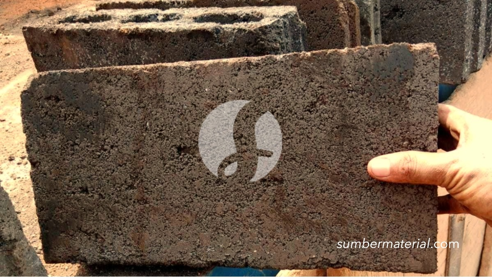

**Cara Memilih Ukuran Batako per Biji yang Sesuai Kebutuhan** - Mitra, ## Memilih Ukuran Batako yang Tepat: Pertimbangkan Kebutuhan Proyek Anda



Ukuran batako per biji memang beragam, tergantung produsen dan jenisnya. Nah, supaya proyek Anda berjalan lancar, penting sekali memilih ukuran yang tepat. Ada batako standar, batako ringan, bahkan batako hollow yang punya dimensi masing-masing.  Tapi jangan khawatir, Mitra, Kami siap membantu Anda menemukan solusi terbaik!  Dengan memperhitungkan kebutuhan proyek dan area yang akan dibangun, Anda bisa meminimalkan sisa material dan menghemat biaya.

## Mengenal Ukuran Batako dan Aplikasinya di Lapangan

Batako ukuran standar biasanya memiliki dimensi panjang 39 cm, lebar 19 cm, dan tinggi 10 cm. Ada juga batako hollow dengan lubang di bagian tengahnya, yang lebih ringan dan hemat material. Ukuran lain, seperti batako dengan dimensi 24x11x5 cm juga populer untuk aplikasi tertentu.

Untuk proyek rumah tinggal, batako ukuran standar sering menjadi pilihan utama karena kuat dan mudah dipasang. Sementara itu, batako hollow lebih disukai untuk bangunan yang membutuhkan insulasi termal dan akustik yang lebih baik.  Nah, bagaimana jika Anda membutuhkan batako untuk pagar rumah?  Batako dengan dimensi yang lebih kecil bisa menjadi solusi praktis.

Tentu saja, menentukan ukuran yang pas tidak hanya soal dimensi. Anda juga perlu mempertimbangkan mutu batako, apakah sudah memenuhi standar SNI atau belum.  Di Sumber Material, Kami hanya menyediakan batako berkualitas tinggi yang terjamin keunggulannya.  Yuk, langsung konsultasikan kebutuhan proyek Anda ke Kami — Mitra bisa langsung dapat penawaran harga terbaik! [tanyakan harga batako](https://api.whatsapp.com/send?phone=6285776786091&text=*Halo%20sumbermaterial.com*%20%3A)

## Mengapa Memesan Batako di Sumber Material? Kemudahan dalam Genggaman Anda

Mitra Sumber Material, bayangkan betapa praktisnya jika Anda tidak perlu repot mencari supplier batako, membandingkan harga, dan mengatur pengiriman sendiri. Di Sumber Material, Kami menyediakan berbagai jenis batako dengan ukuran dan mutu yang beragam.  Anda cukup kirim kebutuhan dan lokasi proyek melalui WhatsApp, dan Kami akan bantu menghitung jumlah batako yang dibutuhkan secara akurat.

Kami melayani pengiriman ke seluruh wilayah Jabodetabek dan sekitarnya, memastikan material sampai di lokasi proyek Anda tepat waktu.  Selain batako, Kami juga menyediakan material bangunan lainnya, seperti pasir, batu, semen, besi, dan baja ringan.  Jadi, Anda bisa mendapatkan semua kebutuhan konstruksi Anda dalam satu tempat!

Dan yang terpenting, Kami selalu mengutamakan kepuasan pelanggan.  Tim Kami siap membantu Anda memilih batako yang paling sesuai dengan anggaran dan spesifikasi proyek Anda.  Untuk konsultasi lebih lanjut, jangan ragu untuk menghubungi Kami.

## Pesan Batako Sekarang: Proses Mudah, Proyek Lancar!

Memesan batako di Sumber Material sangat mudah. Cukup hubungi Kami melalui tombol **WhatsApp** atau **Telepon** di bawah ini. Sampaikan kebutuhan batako Anda (ukuran, jumlah, mutu), serta lokasi proyek Anda. Kami akan segera memberikan penawaran harga terbaik dan mengatur pengiriman secepatnya. Kami juga menyediakan jasa sewa alat berat untuk kelancaran proyek Anda.

## Hitung Kebutuhan Batako: Contoh Kasus Proyek Rumah Minimalis

Mitra, seringkali kita melihat kesalahan dalam memperkirakan kebutuhan batako untuk sebuah proyek bangunan. Banyak yang belum memahami betul bagaimana cara menghitungnya dengan akurat.  Nah, supaya Anda tidak mengalami hal serupa, Kami akan berikan contoh perhitungan sederhana untuk proyek rumah minimalis ukuran 6x8 meter dengan tinggi dinding 3 meter.

Asumsikan Anda menggunakan batako standar berukuran 39x19x10 cm. Pertama, hitung keliling dinding: (6m + 8m) x 2 = 28 meter. Kemudian, hitung luas dinding: 28 meter x 3 meter = 84 meter persegi.  Selanjutnya, hitung luas satu buah batako: 0.39m x 0.19m = 0.0741 meter persegi.

Untuk mengetahui jumlah batako per meter persegi, bagi 1 dengan luas satu buah batako: 1 / 0.0741 = 13.49.  Bulatkan ke atas menjadi 14 batako per meter persegi.  Jadi, total kebutuhan batako adalah 84 meter persegi x 14 batako/meter persegi = 1176 buah batako.

## Perbandingan Batako Standar vs. Batako Hollow: Mana yang Lebih Cocok?

Mitra Sumber Material, memilih antara batako standar dan batako hollow bisa jadi membingungkan. Keduanya punya kelebihan dan kekurangan masing-masing. Batako standar, dengan permukaannya yang padat, ideal untuk dinding yang membutuhkan kekuatan struktural tinggi. Biasanya digunakan untuk dinding penahan beban atau dinding luar yang membutuhkan perlindungan ekstra.

Sementara itu, batako hollow, dengan lubang-lubang di bagian tengahnya, menawarkan beberapa keuntungan.  Pertama, bobotnya lebih ringan, sehingga memudahkan proses pemasangan dan mengurangi beban struktur bangunan. Kedua, memiliki sifat insulasi termal dan akustik yang lebih baik, membuat ruangan lebih nyaman dan hemat energi. Ketiga, membutuhkan lebih sedikit material, sehingga bisa lebih ekonomis.

Namun, perlu diingat bahwa batako hollow kurang cocok untuk dinding penahan beban karena kekuatannya lebih rendah dibandingkan batako standar.  Biasanya, batako hollow digunakan untuk dinding pembatas ruangan, dinding interior, atau pagar rumah.

Berikut perbandingan singkatnya:

## Pertanyaan Umum Seputar Ukuran Batako dan Pemesanannya

Banyak Mitra yang bertanya seputar ukuran batako dan proses pemesanannya. Berikut beberapa pertanyaan yang sering Kami terima:

### Berapa ukuran batako yang paling umum digunakan?

Ukuran batako standar 39x19x10 cm adalah yang paling umum digunakan untuk berbagai jenis proyek bangunan. Namun, ada juga ukuran lain yang tersedia sesuai kebutuhan spesifik Anda.

### Apakah batako perlu direndam sebelum dipasang?

Ya, Mitra, merendam batako dalam air selama beberapa jam sebelum dipasang sangat dianjurkan. Ini akan mengurangi daya serap air batako, meningkatkan kekuatan rekat antara batako dan mortar, serta mencegah retak-retak pada dinding.

### Bagaimana cara menghitung jumlah mortar yang dibutuhkan?

Jumlah mortar yang dibutuhkan tergantung pada ketebalan sambungan antar batako dan jenis mortar yang digunakan. Sebagai perkiraan kasar, Anda membutuhkan sekitar 1 bagian mortar untuk 6-8 bagian batako.  Konsultasikan dengan Kami untuk perhitungan yang lebih akurat.

### Bisakah Kami memesan batako dengan ukuran khusus?

Tentu saja! Kami melayani pemesanan batako dengan ukuran khusus sesuai kebutuhan proyek Anda. Silakan hubungi Kami untuk mendiskusikan detailnya.

## Memahami Kekuatan Tekan Batako: Mengapa Ini Penting

Mitra, kekuatan tekan batako adalah salah satu faktor penting yang perlu dipertimbangkan saat memilih material bangunan ini. Kekuatan tekan menunjukkan kemampuan batako menahan beban vertikal tanpa mengalami kerusakan. Semakin tinggi kekuatan tekannya, semakin baik batako tersebut menahan beban bangunan. Batako dengan kekuatan tekan rendah berisiko retak atau pecah jika dibebani terlalu berat.

Biasanya, kekuatan tekan batako dinyatakan dalam satuan MPa (Mega Pascal). Batako berkualitas baik umumnya memiliki kekuatan tekan minimal 5 MPa, namun ada juga yang mencapai 7.5 MPa atau lebih. Kami di Sumber Material selalu memastikan batako yang Kami sediakan memenuhi standar kekuatan tekan yang relevan untuk berbagai aplikasi konstruksi.

## Kesalahan Umum Saat Membeli Batako: Hindari Kerugian Tak Terduga

Mitra, ada beberapa kesalahan umum yang sering terjadi saat membeli batako. Salah satunya adalah tidak menghitung kebutuhan material dengan cermat, yang bisa menyebabkan kekurangan atau kelebihan batako.  Kesalahan lain adalah memilih batako dengan mutu yang tidak sesuai dengan kebutuhan proyek. Misalnya, menggunakan batako hollow untuk dinding penahan beban.

Selain itu, banyak yang mengabaikan pentingnya memeriksa kondisi batako sebelum membeli. Pastikan tidak ada batako yang retak, pecah, atau cacat lainnya.  Nah, untuk menghindari kerugian tak terduga, Kami sarankan untuk berkonsultasi dengan Kami terlebih dahulu sebelum melakukan pembelian. Kami siap membantu Anda memilih batako yang tepat dan menghitung kebutuhan material secara akurat.

## Pertanyaan Lain Seputar Batako: Jawab Rasa Penasaran Anda

### Apakah batako tahan terhadap cuaca ekstrem?

Batako memiliki daya tahan yang cukup baik terhadap cuaca ekstrem, terutama jika dilapisi dengan pelapis anti air. Namun, paparan jangka panjang terhadap hujan dan panas dapat menyebabkan batako mengalami kerusakan.

### Bagaimana cara memotong batako agar rapi?

Untuk memotong batako agar rapi, gunakan mesin pemotong batako atau gergaji beton dengan mata pisau berlian. Pastikan Anda menggunakan alat pelindung diri yang sesuai, seperti kacamata dan masker.

### Apakah batako bisa digunakan untuk membuat fondasi?

Batako kurang ideal untuk digunakan sebagai material utama fondasi karena kekuatan tekannya yang terbatas. Fondasi sebaiknya dibangun menggunakan beton bertulang yang memiliki kekuatan yang lebih tinggi. Namun, batako bisa digunakan untuk membuat dinding fondasi yang tidak menahan beban berat.

### Bagaimana cara merawat dinding batako agar awet?

Untuk merawat dinding batako agar awet, bersihkan secara berkala dengan air bersih dan sikat lembut. Hindari penggunaan bahan kimia keras yang dapat merusak permukaan batako.  Lapisi dinding batako dengan pelapis anti air untuk melindunginya dari kerusakan akibat cuaca ekstrem.

Mau tahu harga terbaru untuk kebutuhan proyek Mitra Sumber Material? Klik tombol **WhatsApp** atau **Telepon** di bawah, kirim kebutuhan dan lokasi proyek, Kami bantu hitungkan.
