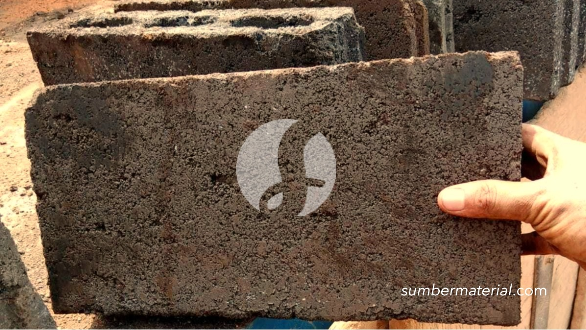

**Pertanyaan Seputar Upah Cetak Batako per Biji yang Sering Muncul** - Mitra Sumber Material yang berbahagia, apakah Anda sedang merencanakan pembangunan dan mempertimbangkan penggunaan batako? Pertanyaan seputar biaya, termasuk upah cetak batako per biji, seringkali menjadi perhatian utama. Nah, Kami di Sumber Material siap membantu Anda mendapatkan solusi terbaik untuk kebutuhan proyek Anda, mulai dari material batako berkualitas hingga jasa cetak yang handal.



Berapa sebenarnya biaya yang perlu Anda siapkan untuk cetak batako? Selain harga batako itu sendiri, upah tenaga kerja adalah komponen penting yang perlu diperhitungkan. Memahami faktor-faktor yang memengaruhi upah ini akan membantu Anda merencanakan anggaran dengan lebih akurat. Di sinilah Kami, Sumber Material, datang untuk memberikan solusi lengkap – tidak hanya menyediakan batako, tetapi juga membantu Anda mencari tukang batako yang terpercaya dan memberikan estimasi biaya yang wajar.

## Estimasi Upah Cetak Batako per Biji dan Pilihan yang Perlu Dipertimbangkan

Upah cetak batako per biji bisa bervariasi tergantung beberapa faktor. Secara umum, Anda akan menemukan kisaran harga antara Rp 300 hingga Rp 700 per biji. Namun, perlu diingat bahwa angka ini hanyalah estimasi dan dapat berbeda-beda tergantung lokasi, kompleksitas desain, dan keahlian tukang. Nah, sebelum memutuskan, ada beberapa hal yang perlu Anda pertimbangkan. Pertama, jenis batako yang digunakan. Batako dengan ukuran atau desain khusus mungkin memerlukan upah yang lebih tinggi. Kedua, volume pesanan. Semakin besar volume, biasanya semakin rendah upah per biji karena ada efisiensi waktu dan tenaga kerja. Ketiga, lokasi proyek Anda. Upah di daerah perkotaan cenderung lebih tinggi dibandingkan di daerah pedesaan.

Mitra Sumber Material, Kami menyarankan untuk selalu membandingkan beberapa penawaran dari tukang batako yang berbeda sebelum membuat keputusan. Jangan ragu untuk bertanya detail mengenai rincian biaya, termasuk biaya cetak, biaya transportasi, dan biaya tambahan lainnya. Jika Anda masih bingung, jangan sungkan untuk [tanyakan harga terbaru](https://api.whatsapp.com/send?phone=6285776786091&text=*Halo%20sumbermaterial.com*%20%3A) ke Kami. Kami bisa membantu menghubungkan Anda dengan tukang batako terpercaya di wilayah Jabodetabek dan memberikan estimasi biaya yang lebih akurat.

## Material Batako Berkualitas untuk Proyek Anda – Tersedia di Sumber Material

Sumber Material menyediakan berbagai jenis batako dengan ukuran dan kualitas yang sesuai dengan kebutuhan proyek Anda. Kami memiliki batako standar, batako hollow, batako press, dan batako ringan. Ukuran yang paling umum digunakan adalah 40x20x10 cm, namun Kami juga menyediakan ukuran lain sesuai permintaan. Batako yang Kami jual terbuat dari bahan berkualitas tinggi dan diproduksi dengan standar SNI, sehingga terjamin kekuatannya dan tahan lama.

Bayangkan Anda membangun dinding pembatas atau pagar rumah. Batako press dengan ketebalan 15 cm akan memberikan kekuatan dan stabilitas yang optimal. Atau, jika Anda membutuhkan material yang lebih ringan untuk mengurangi beban struktur bangunan, batako hollow adalah pilihan yang tepat. Kami juga menyediakan batako ringan yang semakin populer karena kemudahannya dalam pemasangan dan efisiensinya dalam penggunaan semen. Untuk membantu Anda [berapa harga penjelasan](/blog/berapa-harga-batako-per-biji/) memahami lebih jelas berapa harga batako per biji, Kami memiliki artikel panduan yang bisa Anda baca.

## Mengapa Memesan Batako dan Jasa Cetak dari Sumber Material?

Ada beberapa alasan mengapa Mitra Sumber Material sebaiknya mempercayakan kebutuhan batako dan jasa cetak kepada Kami. Pertama, Kami menyediakan material berkualitas tinggi dengan harga yang kompetitif. Kedua, Kami memiliki jaringan tukang batako yang terpercaya dan berpengalaman di wilayah Jabodetabek. Ketiga, Kami menawarkan solusi lengkap – mulai dari pengiriman material langsung ke lokasi proyek hingga jasa urug dan cor jika Anda membutuhkannya. Keempat, Kami berlokasi strategis di Bogor, Jakarta, Bekasi, Karawang, Tangerang, dan Cikarang, sehingga pengiriman lebih cepat dan efisien.

Dengan memesan dari Kami, Anda tidak perlu repot mencari tukang batako sendiri, menegosiasikan harga, dan memastikan kualitas material. Kami akan mengurus semuanya untuk Anda, sehingga Anda bisa fokus pada hal-hal lain yang lebih penting dalam proyek Anda. Kami juga bisa membantu Anda [hal yang biji di Lapangan](/blog/harga-batako-per-biji/) menghitung kebutuhan batako secara akurat dan memberikan solusi terbaik untuk anggaran Anda.

## Pesan dengan Mudah dan Nikmati Kemudahan dari Sumber Material

Memesan batako dan jasa cetak dari Sumber Material sangatlah mudah. Anda bisa menghubungi Kami melalui tombol **Telepon** atau **WhatsApp** yang tersedia di halaman ini. Tim Kami akan dengan senang hati membantu Anda memilih jenis batako yang sesuai dengan kebutuhan Anda, memberikan estimasi biaya yang akurat, dan mengatur jadwal pengiriman yang sesuai dengan waktu Anda.

Kami memahami bahwa setiap proyek memiliki kebutuhan yang berbeda-beda. Itulah mengapa Kami selalu berusaha memberikan pelayanan yang personal dan fleksibel. Jangan ragu untuk menyampaikan kebutuhan spesifik Anda kepada Kami, dan Kami akan berusaha sebaik mungkin untuk mewujudkannya.

Tinggal satu langkah lagi: hubungi Kami lewat tombol **Telepon** atau **WhatsApp** di bawah untuk menanyakan harga dan jadwal pengiriman proyek Mitra Sumber Material.

ARTIKEL_SELESAI

## Memahami Lebih Dalam: Perhitungan Kebutuhan Batako untuk Proyek Anda

Mitra Sumber Material, seringkali kita melihat kesalahan dalam memperkirakan kebutuhan batako untuk sebuah proyek bangunan. Banyak yang belum memahami betul bagaimana cara menghitungnya secara akurat. Nah, Kami akan berikan contoh perhitungan sederhana untuk membantu Anda.

Misalkan Anda ingin membangun dinding dengan panjang 10 meter dan tinggi 3 meter. Jika Anda menggunakan batako ukuran standar 40x20x10 cm, maka langkah pertama adalah menghitung luas dinding: 10 m x 3 m = 30 m². Selanjutnya, hitung luas satu buah batako: 0,4 m x 0,2 m = 0,08 m². Untuk mengetahui jumlah batako yang dibutuhkan, bagi luas dinding dengan luas satu batako: 30 m² / 0,08 m² = 375 buah.

## Pertanyaan Umum Seputar Upah Cetak Batako per Biji

Mitra Sumber Material yang sedang merencanakan pembangunan, seringkali muncul beberapa pertanyaan seputar upah cetak batako per biji. Berikut beberapa pertanyaan yang paling umum Kami terima:

### Berapa Lama Waktu yang Dibutuhkan untuk Mencetak Satu Biji Batako?

Waktu yang dibutuhkan untuk mencetak satu biji batako sangat bervariasi tergantung pada tingkat keahlian tukang dan jenis cetakan yang digunakan. Rata-rata, seorang tukang berpengalaman dapat mencetak sekitar 50-80 biji batako dalam sehari.

### Apakah Upah Cetak Batako Termasuk Biaya Cetakan?

Biasanya, upah cetak batako tidak termasuk biaya cetakan. Cetakan biasanya dimiliki oleh tukang batako atau penyedia jasa cetak. Anda perlu menanyakan secara jelas apakah upah yang ditawarkan sudah termasuk biaya cetakan atau belum.

### Bagaimana Cara Memastikan Kualitas Batako yang Dicetak?

Pastikan tukang batako menggunakan bahan baku yang berkualitas dan mengikuti standar produksi yang benar. Periksa juga hasil cetakan secara berkala untuk memastikan tidak ada cacat atau kerusakan. Kami di Sumber Material hanya menyediakan batako yang sudah jadi dengan kualitas terjamin.

### Apakah Bisa Meminta Tukang Batako untuk Mengantarkan Batako ke Lokasi Proyek?

Tentu saja. Sebagian besar tukang batako juga menyediakan jasa pengantaran batako ke lokasi proyek. Namun, biaya pengantaran biasanya ditambahkan ke dalam upah cetak. Kami juga menyediakan jasa pengiriman batako langsung ke lokasi proyek Anda, sehingga Anda tidak perlu repot lagi.

## Pilihan Batako: Hollow vs. Press – Mana yang Lebih Ekonomis?

Mitra Sumber Material, dalam memilih batako, Anda akan dihadapkan pada beberapa pilihan, salah satunya adalah batako hollow dan batako press. Keduanya memiliki kelebihan dan kekurangan masing-masing. Batako hollow memiliki berat yang lebih ringan dan lebih mudah dipasang, sehingga dapat menghemat waktu dan biaya tenaga kerja. Namun, kekuatannya cenderung lebih rendah dibandingkan batako press.

Sebaliknya, batako press memiliki kekuatan yang lebih tinggi dan lebih tahan lama, namun beratnya lebih berat dan pemasangannya lebih sulit. Secara ekonomis, pilihan terbaik tergantung pada kebutuhan proyek Anda. Jika Anda membangun bangunan bertingkat atau membutuhkan kekuatan yang lebih tinggi, batako press adalah pilihan yang tepat. Namun, jika Anda membangun bangunan sederhana atau pagar rumah, batako hollow bisa menjadi pilihan yang lebih ekonomis. Kami di Sumber Material siap membantu Anda memilih jenis batako yang paling sesuai dengan anggaran dan kebutuhan proyek Anda.
