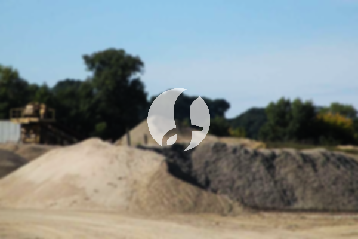

**Cara Memilih Warna Coklat Pasir yang Sesuai Kebutuhan** - Mitra Sumber Material yang budiman, apakah Anda sedang merencanakan proyek konstruksi dan bingung memilih jenis pasir yang tepat? Warna coklat pada pasir seringkali jadi petunjuk kualitasnya, tapi tahukah Anda ada banyak sekali nuansa coklat dan masing-masing punya karakteristik berbeda? Nah, Kami di Sumber Material siap membantu Anda menemukan pasir bangunan dengan warna coklat yang sesuai kebutuhan dan anggaran proyek Anda.



Mitra Sumber Material, pemilihan pasir yang tepat sangat krusial untuk kekuatan dan ketahanan bangunan Anda. Warna coklat pada pasir itu sendiri tidak menjamin kualitas, tapi bisa memberi petunjuk awal tentang kandungan mineral dan asal pasir tersebut. Memahami perbedaan warna coklat pasir dan kaitannya dengan kualitas akan membantu Anda menghindari kesalahan yang bisa merugikan.

## Memahami Variasi Warna Coklat pada Pasir Bangunan

Warna coklat pada pasir berasal dari kandungan mineral seperti besi oksida, mangan, dan lumpur. Semakin tinggi kandungan mineral tersebut, semakin pekat warna coklatnya. Namun, perlu diingat, warna coklat saja tidak cukup untuk menentukan kualitas. Ada beberapa jenis pasir coklat yang umum ditemui di pasaran, masing-masing dengan kelebihan dan kekurangannya. Misalnya, pasir Bangka yang terkenal dengan warna coklat kemerahannya seringkali dipilih karena teksturnya yang halus dan cocok untuk pekerjaan plester dan aci. Sementara itu, pasir sungai yang berwarna coklat kekuningan biasanya lebih kasar dan sering digunakan untuk campuran beton.

Untuk memastikan Anda mendapatkan pasir yang sesuai, penting untuk memperhatikan tidak hanya warnanya, tapi juga ukuran butiran, tingkat kebersihan, dan kandungan lumpur. Jangan ragu untuk meminta contoh sampel ke supplier sebelum membuat keputusan akhir. Kami di Sumber Material siap menyediakan sampel pasir dengan berbagai warna dan tekstur agar Anda bisa memilih yang paling pas untuk proyek Anda. [tanyakan sampel pasir](https://api.whatsapp.com/send?phone=6285776786091&text=*Halo%20sumbermaterial.com*%20%3A)

## Pasir Coklat Terbaik untuk Kebutuhan Proyek Anda: Jenis & Aplikasi

Kami di Sumber Material menyediakan berbagai jenis pasir coklat dengan kualitas terjamin, siap diantar langsung ke lokasi proyek Anda di Jabodetabek dan sekitarnya. Beberapa pilihan populer di antaranya:

- **Pasir Bangka:** Berwarna coklat kemerahan, tekstur halus, ideal untuk plester, aci, dan membuat screed. Harganya relatif lebih tinggi karena kualitasnya yang premium.
- **Pasir Sungai:** Berwarna coklat kekuningan, tekstur bervariasi (kasar hingga sedang), cocok untuk campuran beton, pembuatan pondasi, dan urugan. Pilihan ekonomis untuk proyek besar.
- **Pasir Urug:** Berwarna coklat tua, tekstur kasar, digunakan untuk pengurugan lahan dan stabilisasi tanah. Harga paling terjangkau.

Berikut adalah contoh perbandingan kebutuhan pasir untuk beberapa aplikasi umum:

<table class="table">
  <caption>Estimasi Kebutuhan Pasir (Per Meter Kubik)</caption>
  <thead>
    <tr><th>Aplikasi</th><th>Jenis Pasir yang Dianjurkan</th><th>Estimasi Volume (m3)</th></tr>
  </thead>
  <tbody>
    <tr><td>Plester (10mm)</td><td>Pasir Bangka</td><td>0.01</td></tr>
    <tr><td>Beton K-300 (1 m3)</td><td>Pasir Sungai</td><td>0.6 - 0.8</td></tr>
    <tr><td>Urugan</td><td>Pasir Urug</td><td>Bervariasi, tergantung kedalaman</td></tr>
  </tbody>
</table>

Harga pasir bervariasi tergantung jenis, kualitas, dan volume pemesanan. Harga ini bersifat estimasi dan dapat berubah sewaktu-waktu — hubungi Kami untuk penawaran terbaru dan paling akurat sesuai kebutuhan proyek Mitra.

## Mengapa Memilih Sumber Material untuk Pasir Coklat Berkualitas?

Kami memahami betul betapa pentingnya mendapatkan material bangunan yang berkualitas dan tepat waktu. Itulah mengapa Kami di Sumber Material berkomitmen untuk menyediakan pasir coklat terbaik dengan layanan yang prima. Selain ketersediaan berbagai jenis pasir, Kami juga menawarkan kemudahan pengiriman langsung ke lokasi proyek Anda di wilayah Jabodetabek dan sekitarnya. Anda tidak perlu lagi repot mengurus transportasi sendiri, cukup fokus pada pengerjaan proyek Anda.

Kami berlokasi strategis di Bogor, Jakarta, Bekasi, Karawang, Tangerang, dan Cikarang, sehingga pengiriman bisa dilakukan dengan cepat dan efisien. Kami juga menyediakan jasa urug dan sewa alat berat jika Anda membutuhkan solusi lengkap untuk proyek konstruksi Anda. Dengan memesan melalui Kami, Anda akan mendapatkan:

- **Kualitas Terjamin:** Kami hanya menyediakan pasir dari sumber yang terpercaya dan telah melalui proses seleksi yang ketat.
- **Pilihan Lengkap:** Tersedia berbagai jenis pasir coklat dengan ukuran dan tekstur yang beragam.
- **Pengiriman Cepat & Tepat Waktu:** Kami memastikan material sampai di lokasi proyek Anda sesuai jadwal.
- **Harga Kompetitif:** Kami menawarkan harga yang bersaing dengan kualitas yang tak tertandingi.
- **Pelayanan Ramah & Profesional:** Tim Kami siap membantu Anda memilih pasir yang tepat dan memberikan solusi terbaik untuk proyek Anda.

## Pesan Pasir Coklat Sekarang Juga: Mudah dan Praktis

Memesan pasir coklat dari Sumber Material sangat mudah. Anda bisa langsung menghubungi Kami melalui tombol **WhatsApp** atau **Telepon** di bawah halaman ini untuk mendapatkan penawaran harga terbaru dan informasi ketersediaan stok. Jelaskan kebutuhan proyek Anda secara detail, termasuk jenis pasir, volume yang dibutuhkan, dan lokasi pengiriman. Tim Kami akan segera merespons dan membantu Anda mendapatkan material bangunan yang Anda butuhkan.

## Kalkulasi Kebutuhan Pasir Coklat: Contoh Nyata untuk Proyek Anda

Mitra Sumber Material, seringkali kita kesulitan memperkirakan berapa banyak pasir coklat yang sebenarnya dibutuhkan untuk suatu proyek. Nah, Kami akan berikan contoh perhitungan sederhana untuk membantu Anda merencanakan anggaran dan pemesanan material dengan lebih akurat. Misalnya, Anda akan membuat lantai kerja seluas 50 meter persegi dengan ketebalan 10 cm (0,1 meter).

## Pertanyaan Umum Seputar Pasir Coklat dan Pemilihannya

Mitra Sumber Material, sebelum memutuskan membeli, wajar jika Anda memiliki beberapa pertanyaan. Berikut adalah beberapa pertanyaan yang sering Kami terima dari pelanggan, beserta jawabannya:

### Berapa Perbedaan Pasir Bangka dengan Pasir Pantai?

Pasir Bangka umumnya lebih halus dan bersih dari lumpur dibandingkan pasir pantai. Pasir Bangka ideal untuk pekerjaan finishing seperti plester dan aci, sedangkan pasir pantai lebih cocok untuk campuran beton atau urugan.

### Apakah Warna Pasir Coklat Mempengaruhi Kekuatan Beton?

Tidak secara langsung. Warna coklat menunjukkan kandungan mineral, tetapi kekuatan beton lebih dipengaruhi oleh kualitas semen, air, dan perbandingan campuran (rasio air-semen). Pastikan Anda menggunakan material yang sesuai standar SNI untuk hasil yang optimal.

### Bagaimana Cara Menyimpan Pasir Coklat Agar Tidak Tercampur Kotoran?

Simpan pasir coklat di area yang kering dan terlindungi dari hujan. Tutup dengan terpal atau plastik jika disimpan di luar ruangan untuk mencegah tercampur sampah atau kotoran organik.

### Apakah Sumber Material Melayani Pengiriman Sampel Pasir?

Tentu saja! Kami sangat menganjurkan Anda untuk meminta sampel pasir sebelum melakukan pemesanan. Dengan melihat dan merasakan langsung tekstur dan warnanya, Anda bisa memastikan pasir tersebut sesuai dengan kebutuhan proyek Anda.

## Tips Menghindari Kesalahan Umum Saat Memesan Pasir Coklat

Mitra Sumber Material, ada beberapa kesalahan umum yang sering terjadi saat memesan pasir coklat yang sebaiknya Anda hindari. Pertama, jangan hanya fokus pada warna. Pastikan juga Anda memperhatikan tekstur, kebersihan, dan kandungan lumpur. Kedua, jangan memesan terlalu sedikit atau terlalu banyak. Hitung kebutuhan Anda dengan cermat dan tambahkan sedikit cadangan untuk mengantisipasi kehilangan material. Ketiga, pastikan supplier Anda terpercaya dan dapat menjamin kualitas produknya.

Kami di Sumber Material selalu berusaha memberikan informasi yang jelas dan akurat kepada pelanggan Kami. Kami juga siap membantu Anda menghitung kebutuhan pasir, memilih jenis yang tepat, dan memastikan pengiriman tepat waktu ke lokasi proyek Anda.

## Memastikan Pasir Coklat Bebas Kotoran: Langkah Sederhana

Mitra Sumber Material, kualitas pasir sangat dipengaruhi oleh tingkat kebersihannya. Kotoran seperti lumpur, tanah liat, atau material organik dapat mengurangi kekuatan dan daya rekat adukan. Sebelum digunakan, periksa visual pasir coklat Anda. Jika terdapat banyak kotoran, lakukan penyaringan menggunakan ayakan dengan ukuran mata jaring yang sesuai. Untuk proyek yang membutuhkan presisi tinggi, seperti pelapisan, penyaringan ganda mungkin diperlukan. Kami di Sumber Material memastikan pasir yang Kami sediakan sudah melalui proses pembersihan awal, namun pengecekan tambahan di lokasi proyek tetap disarankan.

## Perbedaan Tekstur Pasir Coklat: Kasus Penggunaan Spesifik

### Pasir Halus untuk Plesteran

Mitra Sumber Material, pasir halus dengan tekstur lembut sangat ideal untuk pekerjaan plesteran. Butiran yang kecil memungkinkan adukan menempel lebih baik pada dinding dan menghasilkan permukaan yang lebih rata.

### Pasir Kasar untuk Fondasi

Untuk fondasi dan struktur beton, pasir kasar dengan butiran yang lebih besar memberikan kekuatan dan stabilitas yang lebih baik. Butiran kasar ini saling mengunci, menciptakan ikatan yang kuat dalam adukan.

### Pasir Menengah untuk Urugan

Jika Anda membutuhkan pasir untuk urugan, pasir dengan tekstur menengah adalah pilihan yang tepat. Ukurannya yang sedang memungkinkan pemadatan yang baik dan mencegah terjadinya pergeseran tanah.

## Pertanyaan Lain Seputar Pasir Coklat yang Sering Kami Terima

### Apakah Pasir Coklat Cocok untuk Kolam Renang?

Tidak disarankan, Mitra. Pasir coklat umumnya mengandung partikel besi yang dapat menyebabkan air kolam renang menjadi keruh dan berkarat. Gunakan pasir khusus kolam renang (silica sand) yang sudah teruji kebersihannya.

### Bagaimana Jika Pasir Coklat Terlalu Berdebu?

Debu pada pasir dapat dihilangkan dengan cara disemprotkan air secara perlahan sambil diaduk. Biarkan pasir mengering sebelum digunakan.

### Apakah Warna Pasir Coklat Bisa Berubah Setelah Dibasahi?

Ya, warna pasir coklat cenderung menjadi lebih gelap setelah dibasahi. Ini adalah hal yang normal dan tidak mempengaruhi kualitasnya.

Jangan tunda kebutuhan proyek Mitra Sumber Material — tanyakan harga dan ketersediaannya sekarang lewat tombol **WhatsApp** atau **Telepon** di bawah halaman ini.
